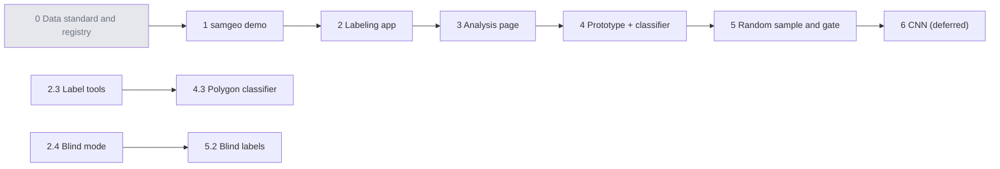
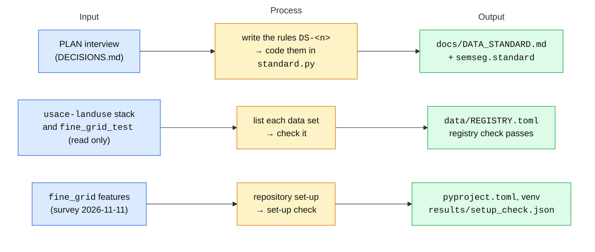
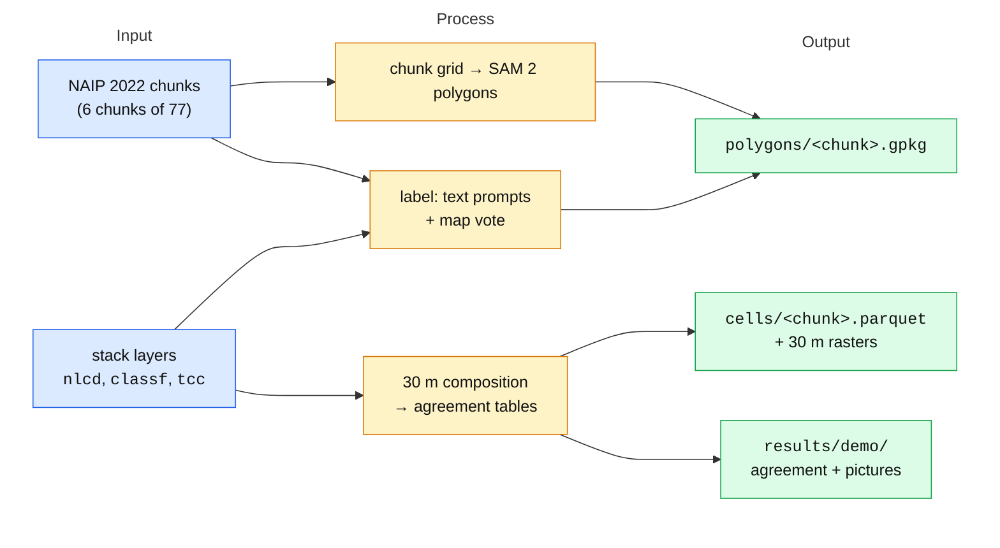
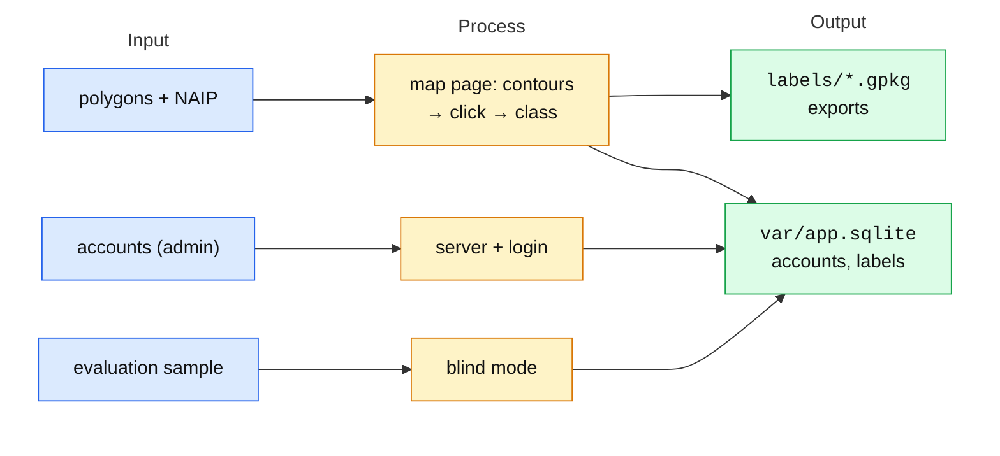
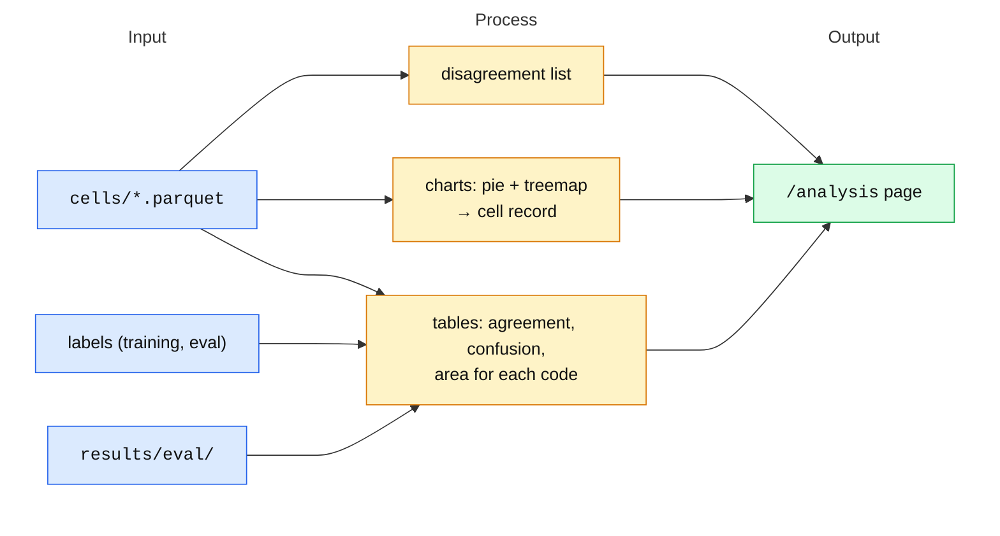
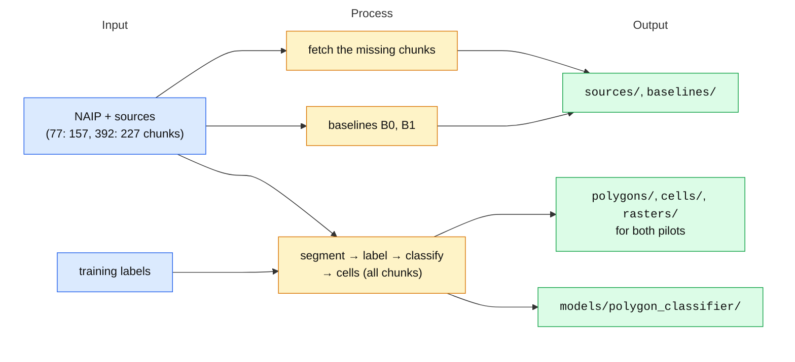
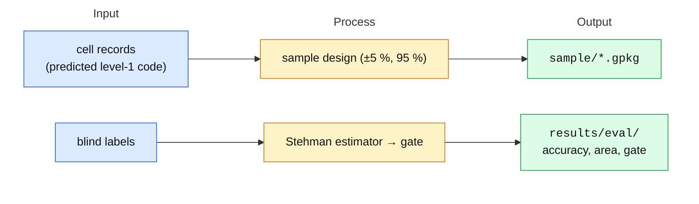
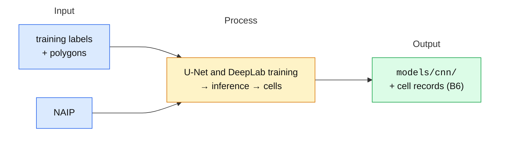
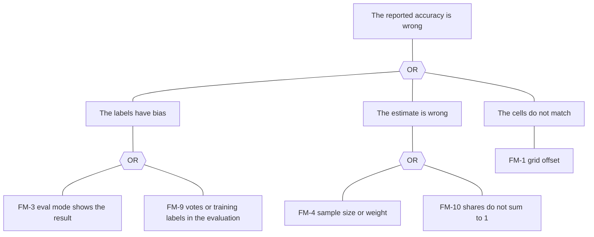

# PLAN.md

The project plan. [`DECISIONS.md`](DECISIONS.md) has the decision log.
[`docs/DATA_STANDARD.md`](docs/DATA_STANDARD.md) has the data rules (`DS-<n>`), and
[`data/REGISTRY.toml`](data/REGISTRY.toml) has the location of each data set. `docs/stages/`
has the notes of each finished stage. [`docs/METHOD_v1.md`](docs/METHOD_v1.md) is a read-only
copy of the `usace-landuse` method v1 (USACE-M classes, condition score, change categories).

| Section | Tool | Question that it answers |
|---|---|---|
| 1 | Goal + requirements (RTM: Requirements Traceability Matrix) | What must the work do, and which test proves each part? |
| 2 | Work breakdown structure (WBS) + overview diagram + Input–Process–Output (IPO) cards | What is the work, in which order, and what goes in and out of each code step? |
| 3 | RAID log (Risks, Assumptions, Issues, Dependencies) | What can stop the work? |
| 4 | Measures (MOE, MOP, TPM) | Does the work reach its goal, and what does it cost? |
| 5 | Interfaces (N² diagram + ICD: Interface Control Document) | What data goes between the stages? |
| 6 | FMEA (Failure Mode and Effects Analysis) + FTA (Fault Tree Analysis) | How can each step fail, and how bad is it? |
| 7 | Execution needs (ERR) | Can the work run with nobody here? |
| — | [`DECISIONS.md`](DECISIONS.md) | What did we decide, and why? |

How to keep this file:

- Each task is a checkbox line. Click "IPO card" under it to open its Input → Process → Output
  diagram (a `<details>` section).
- Mark a task `[x]` when it is done and verified.
- The diagrams come from `PLAN.ipo.json`. Change the card there, then run
  `python3 ~/.claude/skills/project-plan/scripts/render_ipo.py PLAN.md PLAN.ipo.json`.
  Do not edit a diagram under a `<!-- ipo:<id> -->` marker by hand.
- Add each new decision to `DECISIONS.md`, with a link to the task.
- After a change to a data set, run
  `python3 ~/.claude/skills/project-plan/scripts/registry_check.py data/REGISTRY.toml --plan PLAN.md`.

## 1. Goal

Map land cover from the best photo that exists (NAIP 2022, 0.5 m) with semantic
segmentation, and give the result for each 30 m Annual NLCD cell, the unit that the federal
land-cover data sets use. The users are the `usace-landuse` research team (USACE vegetation
inventory, Papers 1 and 2). The pilots are 392 Raystown Lake (PA) and 77 Grapevine Lake (TX).

The work has 3 parts:

1. A prototype with samgeo: SAM 2 polygons on NAIP, a class for each polygon (text prompts,
   a map vote, later a classifier), and a record for each 30 m cell: the class composition,
   the yearly history from the `usace-landuse` stack, and the sources.
2. A web app (login, `vllmPortal` green design, Jack puts it on ngrok) with a labeling page
   (contour lines first, a click gives the class), an analysis page (tables, pie chart,
   treemap), and a blind evaluation mode.
3. A proof of accuracy: a stratified random sample of 30 m cells, with a size n that gives
   ±5 % at 95 % confidence for each area of interest, and a decision gate. Later, our own CNN
   (U-Net, DeepLab) — deferred.

Limits:
- The code is independent of `fine_grid` and `usace_veg`: no import, no copy of their code. The
  data of `fine_grid_test` and the stack is read only ([D3](DECISIONS.md)).
- Large data goes only to the lab share; the repository keeps code and small files ([D23](DECISIONS.md)).
- The GPU is shared with a vLLM server (about 97 GB of 121 GB is in use). No GPU run starts before Jack says so ([D22](DECISIONS.md)).
- Cost: local computer only; no paid API.

### Requirements (RTM)

| ID | Requirement | Measure | Work items | Verification | Level | Status |
|---|---|---|---|---|---|---|
| R1 | Each output raster and each cell ID lies on the Annual NLCD 30 m grid (EPSG:5070, DS-1 to DS-4) | MOP: 0 cells off the grid | [0.2](#t-0-2), [1.4](#t-1-4) | `tests/test_standard.py::test_grid_lattice` | Unit | pass (2026-11-11) |
| R2 | The chunk IDs of the code agree with the `fine_grid` chunk lists | MOP: 0 different IDs on 77 and 392 | [1.1](#t-1-1) | `tests/test_grid.py::test_chunks_match_fine_grid` | Integration | pass (2026-11-11) |
| R3 | Each class code comes from the code table of the data standard (DS-11, DS-12) | MOP: 0 unknown codes | [0.2](#t-0-2), [1.3](#t-1-3) | `tests/test_standard.py::test_code_table` | Unit | pass (2026-11-11) |
| R4 | No module imports or copies `fine_grid` or `usace_veg` | MOP: 0 imports | [0.1](#t-0-1) | `tests/test_independent.py::test_no_foreign_imports` | Unit | pass (2026-11-11) |
| R5 | A missing share stops the step with exit code 3, and no step writes under a read-only root or to the local disk (DS-23 to DS-26) | MOP: 0 local writes | [0.3](#t-0-3) | `tests/test_storage.py::test_share_missing_exit_3` | Unit | pass (2026-11-11) |
| R6 | The data registry agrees with the files on disk and the plan | MOP: `registry_check.py` exit 0 | [0.3](#t-0-3) | `registry_check.py data/REGISTRY.toml --plan PLAN.md` | Integration | pass (2026-11-11) |
| R7 | The class shares of a cell sum to 1 ± 0.001 where the cell has a photo | MOP: 0 cells outside the limit | [1.4](#t-1-4) | `tests/test_cells.py::test_shares_sum_to_one` | Unit | open |
| R8 | The derived NLCD code and USACE-M code follow DS-14 and DS-15 | MOP: each limit tested | [0.2](#t-0-2), [1.4](#t-1-4) | `tests/test_standard.py::test_derived_nlcd_limits` | Unit | pass (2026-11-11) |
| R9 | Each cell record has the history 1985–2025 (NLCD, USACE-M, TCC) and its sources (DS-20, DS-21) | MOP: 41 years in each record | [1.4](#t-1-4) | `tests/test_cells.py::test_record_schema` | Integration | open |
| R10 | The demo runs from NAIP to the agreement tables on 6 chunks of 77 | MOE: Jack reads the demo report | [1.5](#t-1-5) | `tests/test_demo.py::test_demo_on_fixture_chunk` and the report in `results/demo/` | System | open |
| R11 | Each API call except login needs a valid bearer token; passwords use argon2id; 5 failed logins in 1 minute block the address | MOP: 0 calls without a token | [2.1](#t-2-1) | `tests/test_app_auth.py::test_api_needs_token` | Integration | open |
| R12 | A label records the code, the geometry, the labeler, the time, the NAIP year and the mode, and it stays after a server restart | MOP: 0 lost labels | [2.3](#t-2-3) | `tests/test_app_labels.py::test_label_survives_restart` | Integration | open |
| R13 | In evaluation mode, the API sends no model, NLCD or USACE-M field for a sample cell | MOP: 0 such fields | [2.4](#t-2-4) | `tests/test_app_blind.py::test_eval_mode_hides_predictions` | Integration | open |
| R14 | The pages load nothing from outside the server (no CDN) and use the `vllmPortal` design tokens | MOP: 0 external URLs | [2.2](#t-2-2), [3.2](#t-3-2) | `tests/test_app_pages.py::test_no_external_urls` | Unit | open |
| R15 | The analysis page shows the agreement tables, the confusion matrix, the area of each code, a pie chart and a treemap of the composition, and the cell record | MOE: Jack confirms the page | [3.1](#t-3-1), [3.2](#t-3-2), [3.3](#t-3-3) | Jack opens `/analysis` on 77 | Acceptance | open |
| R16 | The fetch step gives the same sources as `fine_grid` (NAIP with year fallback, lidar, Meta CHM, Esri, Chesapeake, Microsoft buildings), fetches only missing chunks, and never writes under `fgt` | MOP: 0 writes under `fgt` | [4.1](#t-4-1) | `tests/test_fetch.py::test_skips_existing_and_readonly` | Integration | open |
| R17 | The sample size n gives ±5 % at 95 % for each area of interest (finite population), with at least 50 cells for each level-1 class present | MOP: n matches the formula | [5.1](#t-5-1) | `tests/test_sample.py::test_sample_size` | Unit | open |
| R18 | The estimator gives overall, user and producer accuracy and the area of each class with 95 % intervals (Stehman stratified estimator) | MOP: equal to a published example | [5.3](#t-5-3) | `tests/test_evaluate.py::test_stehman_example` | Unit | open |
| R19 | The evaluation uses only blind labels (mode `eval`), never the map vote or training labels | MOP: 0 other labels | [5.3](#t-5-3) | `tests/test_evaluate.py::test_only_eval_labels` | Unit | open |
| R20 | Level-1 accuracy ≥ 85 % pooled, no pilot below 75 %, and higher agreement with the blind labels than NLCD 2022 | MOE: the gate result | [5.3](#t-5-3) | `results/eval/gate.md` | Acceptance | open |

## 2. Stages and tasks (WBS + IPO)

Status (2026-11-11): 0.1 Repository set-up is done (uv env: torch 2.14.1+cu130, samgeo 1.4.2; 135 tests, 100 % coverage). 0.2 Data standard in code is done (`semseg.standard`, data standard version 2, draft decisions D27 to D34 for Jack's review; 543 tests, 100 % coverage). 0.3 Storage, registry and set-up check is done (`semseg.storage`, `semseg.setup_check`; `results/setup_check.json` passes with 157 + 227 = 384 NAIP chunks; draft decisions D35 to D40 for Jack's review; 734 tests, 100 % coverage). Stage 0 is done, and its TRR is due. 1.1 Chunk grid is done (`semseg.grid`; `chunks.parquet` for 77 (157 chunks) and 392 (227 chunks) on the share). 1.2 SAM 2 polygons: the code is done (`semseg.segment`, fake-model tests; data standard version 4; 1197 tests, 100 % coverage). Its real run waits for Jack (D22, D42), so [1.2](#t-1-2) stays open. The draft decisions D27 to D50 wait for Jack's review. 1.3 Polygon labels: the code and the fake-model tests are done (`semseg.label`, data standard version 6; 1488 tests, 100 % coverage). Its real LangSAM run waits for Jack (D22), so [1.3](#t-1-3) stays open. The next task is 1.2T SAM 2 tuning for full coverage.



<a id="s-0"></a>
### Stage 0 — Data standard and registry (the rules that all stages obey)

<!-- ipo:S0 -->


**Done when:** `pytest` passes, `registry_check.py data/REGISTRY.toml --plan PLAN.md` exits 0, and `results/setup_check.json` shows the share, the GPU, and 384 NAIP chunks.

<a id="t-0-1"></a>
- [x] **0.1 Repository set-up** ([D3](DECISIONS.md), [D26](DECISIONS.md))

  <details>
  <summary>0.1 IPO card</summary>

  <!-- ipo:0.1 -->
  ```mermaid
  flowchart LR
      subgraph I ["Input"]
          a["<code>fine_grid</code> <code>pyproject.toml</code><br/>(torch cu130, aarch64)"]:::in
          b["samgeo 1.4.2<br/>[samgeo2,text]"]:::in
          c["edge cases: <code>tests/test_edge_*.py</code><br/>scanner and config inputs"]:::in
      end
      subgraph P ["Process: repository set-up"]
          p1["<code>uv sync --python 3.12</code><br/>→ package <code>src/semseg/</code> → pytest"]:::pr
          e1["scanner: keyword, built and alias <code>import_module</code> calls"]:::pr
          e2["scanner: BOM, coding line, directory named <code>x.py</code>"]:::pr
          e3["scanner: symlinked directories, <code>.pyw</code>, <code>.pyi</code>"]:::pr
          e4["config: types of <code>share_root</code> and <code>aois</code>"]:::pr
          e5["config: duplicate keys refused; YAML error as <code>ValueError</code>"]:::pr
      end
      subgraph O ["Output"]
          o1["<code>pyproject.toml</code>, <code>uv.lock</code><br/><code>config.yaml</code>, <code>tests/</code>"]:::ou
          o2["<code>README.md</code>, <code>CLAUDE.md</code><br/>pointers to the plan"]:::ou
          o3["<code>_independence.py</code>, <code>config.py</code><br/>edge faults fixed"]:::ou
      end
      a --> p1
      b --> p1
      p1 --> o1
      p1 --> o2
      c --> e1
      c --> e2
      c --> e3
      c --> e4
      c --> e5
      e1 --> o3
      e2 --> o3
      e3 --> o3
      e4 --> o3
      e5 --> o3
      classDef in fill:#dbeafe,stroke:#2563eb,color:#111
      classDef pr fill:#fef3c7,stroke:#d97706,color:#111
      classDef ou fill:#dcfce7,stroke:#16a34a,color:#111
      style I fill:none,stroke:none
      style P fill:none,stroke:none
      style O fill:none,stroke:none
  ```

  **Done when:** `uv sync` works on the GB10, `import samgeo` works, `pytest` runs, and `test_no_foreign_imports` passes.

  </details>

<a id="t-0-2"></a>
> **CAUTION:** A wrong grid origin moves every cell, and all agreement numbers become wrong (FM-1). Test each DS rule against a real stack raster before any later stage uses the grid.

- [x] **0.2 Data standard in code** ([D5](DECISIONS.md), [D6](DECISIONS.md), [D19](DECISIONS.md), [D27](DECISIONS.md), [D28](DECISIONS.md), [D29](DECISIONS.md), [D30](DECISIONS.md), [D31](DECISIONS.md), [D32](DECISIONS.md), [D33](DECISIONS.md), [D34](DECISIONS.md))

  <details>
  <summary>0.2 IPO card</summary>

  <!-- ipo:0.2 -->
  ```mermaid
  flowchart LR
      subgraph I ["Input"]
          a["<code>docs/DATA_STANDARD.md</code><br/>DS-1 to DS-28"]:::in
          b["<code>usace-landuse</code> <code>scheme.py</code><br/>(USACE-M codes)"]:::in
          c["edge cases: <code>tests/test_edge_standard.py</code><br/>grid, code and ID inputs"]:::in
      end
      subgraph P ["Process: <code>semseg.standard</code>"]
          p1["grid math: cell, chunk, pixel<br/>→ IDs and round trips"]:::pr
          p2["code table, colours<br/>→ NLCD and USACE-M maps"]:::pr
          e1["cell ID and row: int64 limit"]:::pr
          e2["chunk, project, run and polygon IDs: Unicode digits, leading zeros"]:::pr
          e3["share sum: 1.001 and 0.999 bound"]:::pr
          e4["run ID: impossible date, wrong type, newline"]:::pr
          e5["folder names: NUL, backslash, reserved names"]:::pr
          e6["codes: float and array inputs"]:::pr
      end
      subgraph O ["Output"]
          o1["<code>src/semseg/standard.py</code><br/>one function for each rule"]:::ou
          o2["<code>tests/test_standard.py</code><br/>one test for each DS rule"]:::ou
      end
      a --> p1
      a --> p2
      b --> p2
      p1 --> o1
      p2 --> o1
      p1 --> o2
      p2 --> o2
      c --> e1
      c --> e2
      c --> e3
      c --> e4
      c --> e5
      c --> e6
      e1 --> o2
      e2 --> o2
      e3 --> o2
      e4 --> o2
      e5 --> o2
      e6 --> o2
      classDef in fill:#dbeafe,stroke:#2563eb,color:#111
      classDef pr fill:#fef3c7,stroke:#d97706,color:#111
      classDef ou fill:#dcfce7,stroke:#16a34a,color:#111
      style I fill:none,stroke:none
      style P fill:none,stroke:none
      style O fill:none,stroke:none
  ```

  **Done when:** `tests/test_standard.py` has one test for each DS rule, `test_grid_lattice` passes on `nlcd_2022.tif` of 77 and 392, and the USACE-M map agrees with `scheme.py` (changes recorded in DS-16).

  </details>

<a id="t-0-3"></a>
> **CAUTION:** If the share is not mounted, a step must stop. It must not write to the local disk (FM-5).

- [x] **0.3 Storage, registry and set-up check** ([D15](DECISIONS.md), [D23](DECISIONS.md), [D35](DECISIONS.md), [D36](DECISIONS.md), [D37](DECISIONS.md), [D38](DECISIONS.md), [D39](DECISIONS.md), [D40](DECISIONS.md))

  <details>
  <summary>0.3 IPO card</summary>

  <!-- ipo:0.3 -->
  ```mermaid
  flowchart LR
      subgraph I ["Input"]
          a["<code>data/REGISTRY.toml</code><br/>roots and data sets"]:::in
          b["GPU, imports,<br/>pilot layers"]:::in
      end
      subgraph P ["Process: <code>semseg.storage</code>, <code>semseg.setup_check</code>"]
          p1["share guard → safe write<br/>→ read-only roots"]:::pr
          p2["set-up check<br/>→ <code>HF_HOME</code> on the share"]:::pr
      end
      subgraph O ["Output"]
          o1["<code>src/semseg/storage.py</code>"]:::ou
          o2["<code>results/setup_check.json</code><br/>GPU free, layers, NAIP count"]:::ou
      end
      a --> p1
      a --> p2
      b --> p2
      p1 --> o1
      p2 --> o2
      classDef in fill:#dbeafe,stroke:#2563eb,color:#111
      classDef pr fill:#fef3c7,stroke:#d97706,color:#111
      classDef ou fill:#dcfce7,stroke:#16a34a,color:#111
      style I fill:none,stroke:none
      style P fill:none,stroke:none
      style O fill:none,stroke:none
  ```

  **Done when:** `test_share_missing_exit_3` and `test_readonly_roots` pass, the registry check exits 0, and `semseg.setup_check` writes `results/setup_check.json`.

  </details>

<a id="s-1"></a>
### Stage 1 — samgeo demo (Grapevine, 6 chunks; no labels needed)

<!-- ipo:S1 -->


**Done when:** Jack reads `results/demo/README.md`: polygons, 30 m composition, and the agreement with NLCD 2022 and `classf_2022` for 6 chunks of 77.

> **CAUTION:** Tasks 1.2 and 1.3 use the GPU. Do not start a GPU run until Jack says so (D22). The vLLM server holds about 97 GB.

<a id="t-1-1"></a>
- [x] **1.1 Chunk grid** ([D1](DECISIONS.md), [D13](DECISIONS.md), [D43](DECISIONS.md), [D44](DECISIONS.md), [D45](DECISIONS.md))

  <details>
  <summary>1.1 IPO card</summary>

  <!-- ipo:1.1 -->
  ```mermaid
  flowchart LR
      subgraph I ["Input"]
          a["<code>boundary.gpkg</code><br/>(footprint, EPSG:5070)"]:::in
          b["<code>fine_grid</code> <code>chunks.csv</code><br/>(check only)"]:::in
          e["edge cases: <code>tests/test_edge_grid.py</code><br/>(bad footprint, pid, time, Git)"]:::in
      end
      subgraph P ["Process: <code>semseg.grid</code>"]
          p1["buffer 150 m → chunks that touch it<br/>→ IDs <code>r&lt;row&gt;_c&lt;col&gt;</code>"]:::pr
          p2["compare with <code>chunks.csv</code>"]:::pr
      end
      subgraph O ["Output"]
          o1["<code>&lt;pid&gt;/chunks.parquet</code>"]:::ou
          o2["test: same chunk IDs<br/>as <code>fine_grid</code>"]:::ou
      end
      a --> p1
      b --> p2
      e --> p1
      p1 --> o1
      p2 --> o2
      classDef in fill:#dbeafe,stroke:#2563eb,color:#111
      classDef pr fill:#fef3c7,stroke:#d97706,color:#111
      classDef ou fill:#dcfce7,stroke:#16a34a,color:#111
      style I fill:none,stroke:none
      style P fill:none,stroke:none
      style O fill:none,stroke:none
  ```

  **Done when:** `test_chunks_match_fine_grid` passes: 157 chunks for 77 and 227 for 392, with the same IDs as `chunks.csv`.

  </details>

<a id="t-1-2"></a>
- [ ] **1.2 SAM 2 polygons** ([D2](DECISIONS.md), [D8](DECISIONS.md), [D22](DECISIONS.md), [D46](DECISIONS.md), [D47](DECISIONS.md), [D48](DECISIONS.md), [D49](DECISIONS.md), [D50](DECISIONS.md))
  Code done 2026-11-11 (`semseg.segment`, fake-model tests). The real run waits for Jack: `uv run python -m semseg.segment --demo --run`.

  <details>
  <summary>1.2 IPO card</summary>

  <!-- ipo:1.2 -->
  ```mermaid
  flowchart LR
      subgraph I ["Input"]
          a["NAIP chunk<br/>1920 × 1920, 0.5 m"]:::in
          b["SAM 2 weights<br/>(<code>HF_HOME</code> on the share)"]:::in
      end
      subgraph P ["Process: <code>semseg.segment</code>"]
          p1["GPU memory check → SAM 2 masks<br/>→ polygons (clip, simplify, area)"]:::pr
      end
      subgraph O ["Output"]
          o1["<code>polygons/&lt;chunk&gt;.gpkg</code><br/>layer <code>polygons</code>"]:::ou
          o2["<code>runs/&lt;run_id&gt;/log</code><br/>time, GPU memory"]:::ou
      end
      a --> p1
      b --> p1
      p1 --> o1
      p1 --> o2
      classDef in fill:#dbeafe,stroke:#2563eb,color:#111
      classDef pr fill:#fef3c7,stroke:#d97706,color:#111
      classDef ou fill:#dcfce7,stroke:#16a34a,color:#111
      style I fill:none,stroke:none
      style P fill:none,stroke:none
      style O fill:none,stroke:none
  ```

  **Done when:** on a fixture chunk (a test with a fake model) the polygons are valid, inside the chunk, in EPSG:5070, with DS-21 metadata; after Jack says "run", the 6 demo chunks have polygon files and the run log shows the GPU memory.

  </details>

<a id="t-1-3"></a>
> **CAUTION:** Text prompts can miss classes (shrub, maintained grass, other paved) (FM-2). The demo report must list each code with 0 polygons.

- [ ] **1.3 Polygon labels: text prompts and map vote** ([D8](DECISIONS.md), [D6](DECISIONS.md))

  <details>
  <summary>1.3 IPO card</summary>

  <!-- ipo:1.3 -->
  ```mermaid
  flowchart LR
      subgraph I ["Input"]
          a["<code>polygons/&lt;chunk&gt;.gpkg</code>"]:::in
          b["NAIP chunk"]:::in
          c["code table<br/>(prompt for each code)"]:::in
          d["<code>nlcd_2022</code>, <code>classf_2022</code>"]:::in
      end
      subgraph P ["Process: <code>semseg.label</code>"]
          p1["LangSAM: one prompt for each code<br/>→ mask overlap with each polygon"]:::pr
          p2["map vote: majority code<br/>under each polygon"]:::pr
      end
      subgraph O ["Output"]
          o1["columns <code>code_prompt</code>, <code>p_prompt</code>"]:::ou
          o2["columns <code>code_vote</code>, <code>p_vote</code>"]:::ou
      end
      a --> p1
      b --> p1
      c --> p1
      a --> p2
      d --> p2
      p1 --> o1
      p2 --> o2
      classDef in fill:#dbeafe,stroke:#2563eb,color:#111
      classDef pr fill:#fef3c7,stroke:#d97706,color:#111
      classDef ou fill:#dcfce7,stroke:#16a34a,color:#111
      style I fill:none,stroke:none
      style P fill:none,stroke:none
      style O fill:none,stroke:none
  ```

  **Done when:** each polygon has `code_prompt` and `code_vote` from the code table (`test_code_table`), and the vote uses only `nlcd_2022` and `classf_2022`.

  </details>

  Code and fake-model tests done (2026-11-11, commit 2a8995c and the 1.3 fix commit). The real LangSAM run waits for Jack (D22).

<a id="t-1-4"></a>
> **CAUTION:** SAM masks overlap. Shares from overlapped masks do not sum to 1 (FM-10). Rasterise with one code for each pixel before the shares.

- [ ] **1.4 30 m cell records** ([D18](DECISIONS.md), [D19](DECISIONS.md))

  <details>
  <summary>1.4 IPO card</summary>

  <!-- ipo:1.4 -->
  ```mermaid
  flowchart LR
      subgraph I ["Input"]
          a["labelled polygons"]:::in
          b["stack history<br/>1985–2025"]:::in
          c["NAIP <code>source_rank</code><br/>and tags"]:::in
      end
      subgraph P ["Process: <code>semseg.cells</code>"]
          p1["rasterise at 0.5 m → shares<br/>for each 30 m cell → top code"]:::pr
          p2["derived NLCD (DS-14)<br/>and USACE-M (DS-15)"]:::pr
          p3["join history and sources"]:::pr
      end
      subgraph O ["Output"]
          o1["<code>cells/&lt;chunk&gt;.parquet</code><br/>(DS-20)"]:::ou
          o2["<code>rasters/top.tif</code>, <code>shares.tif</code><br/><code>nlcd_derived.tif</code>"]:::ou
      end
      a --> p1
      a --> p2
      b --> p3
      c --> p3
      p1 --> o1
      p1 --> o2
      p2 --> o1
      p2 --> o2
      p3 --> o1
      classDef in fill:#dbeafe,stroke:#2563eb,color:#111
      classDef pr fill:#fef3c7,stroke:#d97706,color:#111
      classDef ou fill:#dcfce7,stroke:#16a34a,color:#111
      style I fill:none,stroke:none
      style P fill:none,stroke:none
      style O fill:none,stroke:none
  ```

  **Done when:** `test_shares_sum_to_one`, `test_record_schema` and `test_derived_nlcd_limits` pass, and the rasters line up with `nlcd_2022.tif` (`test_grid_lattice`).

  </details>

<a id="t-1-5"></a>
- [ ] **1.5 Demo report**

  <details>
  <summary>1.5 IPO card</summary>

  <!-- ipo:1.5 -->
  ```mermaid
  flowchart LR
      subgraph I ["Input"]
          a["<code>cells/&lt;chunk&gt;.parquet</code>"]:::in
          b["<code>polygons/&lt;chunk&gt;.gpkg</code>"]:::in
      end
      subgraph P ["Process: <code>semseg.demo_report</code>"]
          p1["agreement with NLCD 2022<br/>and <code>classf_2022</code> → confusion"]:::pr
          p2["count of polygons for each code<br/>→ codes with 0"]:::pr
          p3["picture of each chunk"]:::pr
      end
      subgraph O ["Output"]
          o1["<code>results/demo/agreement.csv</code>"]:::ou
          o2["<code>results/demo/codes.csv</code>"]:::ou
          o3["<code>results/demo/*.png</code><br/>+ <code>README.md</code>"]:::ou
      end
      a --> p1
      b --> p2
      b --> p3
      p1 --> o1
      p2 --> o2
      p3 --> o3
      classDef in fill:#dbeafe,stroke:#2563eb,color:#111
      classDef pr fill:#fef3c7,stroke:#d97706,color:#111
      classDef ou fill:#dcfce7,stroke:#16a34a,color:#111
      style I fill:none,stroke:none
      style P fill:none,stroke:none
      style O fill:none,stroke:none
  ```

  **Done when:** `results/demo/` has `agreement.csv`, `codes.csv`, one picture for each chunk, and a `README.md` that states the numbers are agreement with maps, not accuracy.

  </details>

<a id="s-2"></a>
### Stage 2 — Labeling app (contour lines first, a click gives the class)

<!-- ipo:S2 -->


**Done when:** Jack logs in through ngrok, labels 10 polygons on 77 (one merge, one cut, one hand-drawn polygon), and finds the labels in the export after a server restart.

<a id="t-2-1"></a>
> **CAUTION:** The app goes on ngrok, so any person on the internet can reach it. Each API call except login must check the token (FM-7).

- [ ] **2.1 Server, accounts and login** ([D16](DECISIONS.md))

  <details>
  <summary>2.1 IPO card</summary>

  <!-- ipo:2.1 -->
  ```mermaid
  flowchart LR
      subgraph I ["Input"]
          a["<code>USDA-LFD-LLM</code> <code>queue_server.py</code><br/>(login pattern)"]:::in
          b["<code>vllmPortal</code> <code>portal.py</code><br/>(server pattern)"]:::in
      end
      subgraph P ["Process: <code>semseg.app</code>"]
          p1["stdlib server, port 8795<br/>→ argon2id, bearer tokens, roles<br/>→ rate limit"]:::pr
      end
      subgraph O ["Output"]
          o1["<code>src/semseg/app/server.py</code><br/><code>store.py</code>"]:::ou
          o2["<code>var/app.sqlite</code><br/>users, sessions"]:::ou
      end
      a --> p1
      b --> p1
      p1 --> o1
      p1 --> o2
      classDef in fill:#dbeafe,stroke:#2563eb,color:#111
      classDef pr fill:#fef3c7,stroke:#d97706,color:#111
      classDef ou fill:#dcfce7,stroke:#16a34a,color:#111
      style I fill:none,stroke:none
      style P fill:none,stroke:none
      style O fill:none,stroke:none
  ```

  **Done when:** `test_api_needs_token`, a login rate-limit test and a role test pass; `semseg.app adduser --role admin` makes the first account.

  </details>

<a id="t-2-2"></a>
- [ ] **2.2 Map page** ([D16](DECISIONS.md), [D17](DECISIONS.md))

  <details>
  <summary>2.2 IPO card</summary>

  <!-- ipo:2.2 -->
  ```mermaid
  flowchart LR
      subgraph I ["Input"]
          a["NAIP chunks"]:::in
          b["<code>polygons/&lt;chunk&gt;.gpkg</code>"]:::in
          c["<code>vllmPortal</code> design tokens"]:::in
      end
      subgraph P ["Process: map page"]
          p1["image tiles from the chunks"]:::pr
          p2["polygons as GeoJSON contours"]:::pr
          p3["page: Leaflet (vendored)<br/>+ green design"]:::pr
      end
      subgraph O ["Output"]
          o1["<code>/label</code> page"]:::ou
          o2["<code>static/leaflet/</code>"]:::ou
      end
      a --> p1
      b --> p2
      c --> p3
      p1 --> o1
      p2 --> o1
      p3 --> o1
      p3 --> o2
      classDef in fill:#dbeafe,stroke:#2563eb,color:#111
      classDef pr fill:#fef3c7,stroke:#d97706,color:#111
      classDef ou fill:#dcfce7,stroke:#16a34a,color:#111
      style I fill:none,stroke:none
      style P fill:none,stroke:none
      style O fill:none,stroke:none
  ```

  **Done when:** the `/label` page shows NAIP and the polygon contours of a chunk, `test_no_external_urls` passes, and the page uses the `vllmPortal` tokens in light and dark mode.

  </details>

<a id="t-2-3"></a>
> **CAUTION:** A lost label costs a person's time (FM-8). Each save is one SQLite transaction (WAL), and the export runs each night.

- [ ] **2.3 Label tools** ([D7](DECISIONS.md), [D9](DECISIONS.md), [D10](DECISIONS.md))

  <details>
  <summary>2.3 IPO card</summary>

  <!-- ipo:2.3 -->
  ```mermaid
  flowchart LR
      subgraph I ["Input"]
          a["a click on a polygon"]:::in
          b["code table, 2 levels"]:::in
          c["table <code>labels</code>"]:::in
      end
      subgraph P ["Process: label tools"]
          p1["select the code → save<br/>→ undo"]:::pr
          p2["merge, cut, draw by hand"]:::pr
          p3["export (nightly, admin)"]:::pr
      end
      subgraph O ["Output"]
          o1["table <code>labels</code><br/>(labeler, time, NAIP year, geometry)"]:::ou
          o2["<code>labels/&lt;date&gt;.gpkg</code>"]:::ou
      end
      a --> p1
      b --> p1
      a --> p2
      c --> p3
      p1 --> o1
      p2 --> o1
      p3 --> o2
      classDef in fill:#dbeafe,stroke:#2563eb,color:#111
      classDef pr fill:#fef3c7,stroke:#d97706,color:#111
      classDef ou fill:#dcfce7,stroke:#16a34a,color:#111
      style I fill:none,stroke:none
      style P fill:none,stroke:none
      style O fill:none,stroke:none
  ```

  **Done when:** `test_label_survives_restart` passes, and the merge, cut, draw and undo tests pass.

  </details>

<a id="t-2-4"></a>
> **CAUTION:** If a labeler sees the model result or the map in evaluation mode, the accuracy has bias and the proof fails (FM-3).

- [ ] **2.4 Blind evaluation mode** ([D10](DECISIONS.md))

  <details>
  <summary>2.4 IPO card</summary>

  <!-- ipo:2.4 -->
  ```mermaid
  flowchart LR
      subgraph I ["Input"]
          a["<code>sample/*.gpkg</code>"]:::in
          b["role of the user"]:::in
      end
      subgraph P ["Process: blind mode"]
          p1["sample queue → cell only<br/>→ hide model, NLCD, USACE-M"]:::pr
          p2["results for admin only"]:::pr
      end
      subgraph O ["Output"]
          o1["table <code>labels</code>, mode <code>eval</code>"]:::ou
          o2["test: the API sends<br/>no prediction field in eval mode"]:::ou
      end
      a --> p1
      b --> p1
      b --> p2
      p1 --> o1
      p1 --> o2
      p2 --> o2
      classDef in fill:#dbeafe,stroke:#2563eb,color:#111
      classDef pr fill:#fef3c7,stroke:#d97706,color:#111
      classDef ou fill:#dcfce7,stroke:#16a34a,color:#111
      style I fill:none,stroke:none
      style P fill:none,stroke:none
      style O fill:none,stroke:none
  ```

  **Done when:** `test_eval_mode_hides_predictions` passes for every API route that a labeler can call, and only an admin sees the evaluation results.

  </details>

<a id="s-3"></a>
### Stage 3 — Analysis page

<!-- ipo:S3 -->


**Done when:** Jack opens `/analysis` for 77 and confirms the tables, the pie chart, the treemap, the cell record, and the disagreement list (R15).

<a id="t-3-1"></a>
- [ ] **3.1 Agreement tables and confusion matrix** ([D14](DECISIONS.md))

  <details>
  <summary>3.1 IPO card</summary>

  <!-- ipo:3.1 -->
  ```mermaid
  flowchart LR
      subgraph I ["Input"]
          a["<code>cells/*.parquet</code>"]:::in
          b["labels (training)"]:::in
          c["<code>results/eval/*.csv</code>"]:::in
      end
      subgraph P ["Process: analysis tables"]
          p1["agreement with NLCD and USACE-M<br/>→ confusion matrix"]:::pr
          p2["area for each code and project"]:::pr
      end
      subgraph O ["Output"]
          o1["API <code>/api/analysis/*</code><br/>+ tables on the page"]:::ou
      end
      a --> p1
      b --> p1
      c --> p1
      a --> p2
      p1 --> o1
      p2 --> o1
      classDef in fill:#dbeafe,stroke:#2563eb,color:#111
      classDef pr fill:#fef3c7,stroke:#d97706,color:#111
      classDef ou fill:#dcfce7,stroke:#16a34a,color:#111
      style I fill:none,stroke:none
      style P fill:none,stroke:none
      style O fill:none,stroke:none
  ```

  **Done when:** the API numbers agree with `results/demo/agreement.csv` for the demo chunks (a test).

  </details>

<a id="t-3-2"></a>
- [ ] **3.2 Composition charts and cell record** ([D14](DECISIONS.md), [D17](DECISIONS.md), [D18](DECISIONS.md))

  <details>
  <summary>3.2 IPO card</summary>

  <!-- ipo:3.2 -->
  ```mermaid
  flowchart LR
      subgraph I ["Input"]
          a["cell record (DS-20)"]:::in
          b["code colours (DS-13)"]:::in
      end
      subgraph P ["Process: composition charts"]
          p1["pie (donut) of the composition"]:::pr
          p2["treemap (squarified)<br/>cell, chunk, project"]:::pr
          p3["history timeline<br/>1985–2025"]:::pr
      end
      subgraph O ["Output"]
          o1["inline SVG charts<br/>+ cell panel"]:::ou
      end
      a --> p1
      b --> p1
      a --> p2
      b --> p2
      a --> p3
      p1 --> o1
      p2 --> o1
      p3 --> o1
      classDef in fill:#dbeafe,stroke:#2563eb,color:#111
      classDef pr fill:#fef3c7,stroke:#d97706,color:#111
      classDef ou fill:#dcfce7,stroke:#16a34a,color:#111
      style I fill:none,stroke:none
      style P fill:none,stroke:none
      style O fill:none,stroke:none
  ```

  **Done when:** a test checks that the treemap areas are in proportion to the shares (± 1 %), each chart has a legend with the code names, and the cell panel shows the 41 history years.

  </details>

<a id="t-3-3"></a>
- [ ] **3.3 Disagreement list** ([D14](DECISIONS.md))

  <details>
  <summary>3.3 IPO card</summary>

  <!-- ipo:3.3 -->
  ```mermaid
  flowchart LR
      subgraph I ["Input"]
          a["cell records"]:::in
          b["stack codes"]:::in
      end
      subgraph P ["Process: disagreement list"]
          p1["cells where the sources disagree<br/>→ sort by area → link to <code>/label</code>"]:::pr
      end
      subgraph O ["Output"]
          o1["disagreement list"]:::ou
      end
      a --> p1
      b --> p1
      p1 --> o1
      classDef in fill:#dbeafe,stroke:#2563eb,color:#111
      classDef pr fill:#fef3c7,stroke:#d97706,color:#111
      classDef ou fill:#dcfce7,stroke:#16a34a,color:#111
      style I fill:none,stroke:none
      style P fill:none,stroke:none
      style O fill:none,stroke:none
  ```

  **Done when:** the list sorts the cells by area of disagreement, and each row opens the cell on `/label`.

  </details>

<a id="s-4"></a>
### Stage 4 — Prototype on both pilots + polygon classifier

<!-- ipo:S4 -->


**Done when:** 77 and 392 have polygons, cell records and rasters for all 384 chunks, and the classifier has a cross-validated accuracy on the training labels (by chunk).

<a id="t-4-1"></a>
> **CAUTION:** `fine_grid_test` is read only. The fetch must never write or delete a file there (FM-11).

- [ ] **4.1 Fetch (feature parity with `fine_grid`)** ([D20](DECISIONS.md))

  <details>
  <summary>4.1 IPO card</summary>

  <!-- ipo:4.1 -->
  ```mermaid
  flowchart LR
      subgraph I ["Input"]
          a["<code>chunks.parquet</code>"]:::in
          b["<code>fine_grid_test</code> files<br/>(read only)"]:::in
          c["Planetary Computer, AWS,<br/>Microsoft buildings"]:::in
      end
      subgraph P ["Process: <code>semseg.fetch</code>"]
          p1["for each chunk and source: exists?<br/>→ fetch only the missing<br/>→ safe write, resume, log"]:::pr
      end
      subgraph O ["Output"]
          o1["<code>sources/&lt;source&gt;/&lt;chunk&gt;.tif</code>"]:::ou
          o2["<code>runs/&lt;run_id&gt;/fetch.csv</code>"]:::ou
      end
      a --> p1
      b --> p1
      c --> p1
      p1 --> o1
      p1 --> o2
      classDef in fill:#dbeafe,stroke:#2563eb,color:#111
      classDef pr fill:#fef3c7,stroke:#d97706,color:#111
      classDef ou fill:#dcfce7,stroke:#16a34a,color:#111
      style I fill:none,stroke:none
      style P fill:none,stroke:none
      style O fill:none,stroke:none
  ```

  **Done when:** `test_skips_existing_and_readonly` passes, and a dry run on 77 and 392 reports 0 missing chunks.

  </details>

  D57: fetch only NAIP with a 0.6 m source GSD; if 2022 has none, the nearest year with 0.6 m; record naip_year.

<a id="t-4-2"></a>
- [ ] **4.2 Baselines B0 and B1** ([D20](DECISIONS.md))

  <details>
  <summary>4.2 IPO card</summary>

  <!-- ipo:4.2 -->
  ```mermaid
  flowchart LR
      subgraph I ["Input"]
          a["stack <code>classf_2022</code>, <code>nlcd_2022</code>"]:::in
          b["buildings, roads, CHM, NDVI,<br/>water vectors"]:::in
      end
      subgraph P ["Process: <code>semseg.baselines</code>"]
          p1["B0: copy the 30 m map"]:::pr
          p2["B1: rules on the ready layers"]:::pr
      end
      subgraph O ["Output"]
          o1["<code>baselines/b0/&lt;chunk&gt;.parquet</code>"]:::ou
          o2["<code>baselines/b1/&lt;chunk&gt;.parquet</code>"]:::ou
      end
      a --> p1
      b --> p2
      p1 --> o1
      p2 --> o2
      classDef in fill:#dbeafe,stroke:#2563eb,color:#111
      classDef pr fill:#fef3c7,stroke:#d97706,color:#111
      classDef ou fill:#dcfce7,stroke:#16a34a,color:#111
      style I fill:none,stroke:none
      style P fill:none,stroke:none
      style O fill:none,stroke:none
  ```

  **Done when:** B0 and B1 have cell records with the DS-20 schema for the demo chunks (a test).

  </details>

<a id="t-4-3"></a>
- [ ] **4.3 Polygon classifier** ([D8](DECISIONS.md))

  <details>
  <summary>4.3 IPO card</summary>

  <!-- ipo:4.3 -->
  ```mermaid
  flowchart LR
      subgraph I ["Input"]
          a["polygons + NAIP + heights"]:::in
          b["training labels<br/>(<code>labels/*.gpkg</code>)"]:::in
      end
      subgraph P ["Process: <code>semseg.classify</code>"]
          p1["features: bands, NDVI, texture,<br/>height, shape, prompt and vote"]:::pr
          p2["train → cross-validate by chunk"]:::pr
      end
      subgraph O ["Output"]
          o1["<code>models/polygon_classifier/</code>"]:::ou
          o2["column <code>code_clf</code>, <code>p_clf</code>"]:::ou
      end
      a --> p1
      b --> p2
      p1 --> o2
      p2 --> o1
      classDef in fill:#dbeafe,stroke:#2563eb,color:#111
      classDef pr fill:#fef3c7,stroke:#d97706,color:#111
      classDef ou fill:#dcfce7,stroke:#16a34a,color:#111
      style I fill:none,stroke:none
      style P fill:none,stroke:none
      style O fill:none,stroke:none
  ```

  **Done when:** the classifier trains on the S2 training labels, a test checks that the cross-validation folds split by chunk, and the report gives the accuracy for each level-1 code.

  </details>

<a id="t-4-4"></a>
> **CAUTION:** This is the long GPU run. Do not start it until Jack says so (D22).

- [ ] **4.4 Full run on 77 and 392** ([D22](DECISIONS.md))

  <details>
  <summary>4.4 IPO card</summary>

  <!-- ipo:4.4 -->
  ```mermaid
  flowchart LR
      subgraph I ["Input"]
          a["all chunks of 77 and 392"]:::in
          b["classifier model"]:::in
      end
      subgraph P ["Process: <code>semseg.run</code>"]
          p1["segment → label → classify<br/>→ cells, resume by chunk"]:::pr
      end
      subgraph O ["Output"]
          o1["<code>polygons/</code>, <code>cells/</code>, <code>rasters/</code><br/>(both pilots)"]:::ou
          o2["<code>runs/&lt;run_id&gt;/</code><br/>time, GPU memory"]:::ou
      end
      a --> p1
      b --> p1
      p1 --> o1
      p1 --> o2
      classDef in fill:#dbeafe,stroke:#2563eb,color:#111
      classDef pr fill:#fef3c7,stroke:#d97706,color:#111
      classDef ou fill:#dcfce7,stroke:#16a34a,color:#111
      style I fill:none,stroke:none
      style P fill:none,stroke:none
      style O fill:none,stroke:none
  ```

  **Done when:** the registry check shows `polygons`, `cells` and `cell_rasters` present for 384 chunks, and a second run skips the finished chunks.

  </details>

<a id="s-5"></a>
### Stage 5 — Random sample, blind labels and the gate

<!-- ipo:S5 -->


**Done when:** `results/eval/gate.md` gives the accuracy and area of each class with 95 % intervals for 77 and 392, and the gate result (D24).

<a id="t-5-1"></a>
> **CAUTION:** A wrong sample size or a wrong weight makes the 95 % interval wrong, and nobody sees it (FM-4). Test the formula and the weights against a known example.

- [ ] **5.1 Sample design** ([D11](DECISIONS.md), [D13](DECISIONS.md))

  <details>
  <summary>5.1 IPO card</summary>

  <!-- ipo:5.1 -->
  ```mermaid
  flowchart LR
      subgraph I ["Input"]
          a["cells in the area of interest<br/>(footprint + 150 m)"]:::in
          b["seed, margin, minimum per class"]:::in
      end
      subgraph P ["Process: <code>semseg.sample</code>"]
          p1["n from N (finite population)<br/>→ allocate by stratum (≥ 50)<br/>→ random cells"]:::pr
      end
      subgraph O ["Output"]
          o1["<code>sample/&lt;date&gt;.gpkg</code><br/>weights, order"]:::ou
          o2["sample queue in the app"]:::ou
      end
      a --> p1
      b --> p1
      p1 --> o1
      p1 --> o2
      classDef in fill:#dbeafe,stroke:#2563eb,color:#111
      classDef pr fill:#fef3c7,stroke:#d97706,color:#111
      classDef ou fill:#dcfce7,stroke:#16a34a,color:#111
      style I fill:none,stroke:none
      style P fill:none,stroke:none
      style O fill:none,stroke:none
  ```

  **Done when:** `test_sample_size` passes (for N = 70,474 cells, n = 383 before the class minimum), the seed is in the sample file, and the queue shows in blind mode.

  </details>

<a id="t-5-2"></a>
- [ ] **5.2 Blind labels of the sample (people)** ([D10](DECISIONS.md))

  <!-- no-ipo:5.2 -->

  **Done when:** each sample cell of 77 and 392 has a blind label (about 800 cells; about 7 h at 30 s for each cell).

<a id="t-5-3"></a>
> **CAUTION:** The evaluation must read only the blind labels. A map vote or a training label in the evaluation is circular (FM-9).

- [ ] **5.3 Estimator and gate** ([D11](DECISIONS.md), [D24](DECISIONS.md))

  <details>
  <summary>5.3 IPO card</summary>

  <!-- ipo:5.3 -->
  ```mermaid
  flowchart LR
      subgraph I ["Input"]
          a["blind labels (mode <code>eval</code>)"]:::in
          b["sample weights"]:::in
          c["our codes, NLCD 2022,<br/><code>classf_2022</code>"]:::in
      end
      subgraph P ["Process: <code>semseg.evaluate</code>"]
          p1["Stehman: overall, user, producer accuracy<br/>→ area with 95 % intervals"]:::pr
          p2["gate (D24)"]:::pr
      end
      subgraph O ["Output"]
          o1["<code>results/eval/accuracy.csv</code><br/><code>area.csv</code>"]:::ou
          o2["<code>results/eval/gate.md</code>"]:::ou
      end
      a --> p1
      b --> p1
      c --> p1
      c --> p2
      a --> p2
      p1 --> o1
      p2 --> o2
      classDef in fill:#dbeafe,stroke:#2563eb,color:#111
      classDef pr fill:#fef3c7,stroke:#d97706,color:#111
      classDef ou fill:#dcfce7,stroke:#16a34a,color:#111
      style I fill:none,stroke:none
      style P fill:none,stroke:none
      style O fill:none,stroke:none
  ```

  **Done when:** `test_stehman_example` and `test_only_eval_labels` pass, and `results/eval/gate.md` exists.

  </details>

<a id="s-6"></a>
### Stage 6 — Our own CNN (U-Net, DeepLab) — deferred

<!-- ipo:S6 -->


**Done when:** the CNN cell records go through the same evaluation (5.3) as the prototype.

<a id="t-6-1"></a>
- [ ] **6.1 Training set from the labels** ([D25](DECISIONS.md)) — deferred

  <details>
  <summary>6.1 IPO card</summary>

  <!-- ipo:6.1 -->
  ```mermaid
  flowchart LR
      subgraph I ["Input"]
          a["labels + polygons"]:::in
          b["NAIP chunks"]:::in
      end
      subgraph P ["Process: training set"]
          p1["rasterise labels<br/>→ tiles → split by chunk"]:::pr
      end
      subgraph O ["Output"]
          o1["training tiles on the share"]:::ou
      end
      a --> p1
      b --> p1
      p1 --> o1
      classDef in fill:#dbeafe,stroke:#2563eb,color:#111
      classDef pr fill:#fef3c7,stroke:#d97706,color:#111
      classDef ou fill:#dcfce7,stroke:#16a34a,color:#111
      style I fill:none,stroke:none
      style P fill:none,stroke:none
      style O fill:none,stroke:none
  ```

  **Done when:** the training tiles split by chunk, with no sample cell in a training tile.

  </details>

<a id="t-6-2"></a>
- [ ] **6.2 U-Net and DeepLab training and inference** ([D25](DECISIONS.md)) — deferred

  <details>
  <summary>6.2 IPO card</summary>

  <!-- ipo:6.2 -->
  ```mermaid
  flowchart LR
      subgraph I ["Input"]
          a["training tiles"]:::in
      end
      subgraph P ["Process: CNN"]
          p1["U-Net, DeepLabv3+ (smp)<br/>→ inference → cells"]:::pr
      end
      subgraph O ["Output"]
          o1["<code>models/cnn/</code>"]:::ou
          o2["cell records, method <code>cnn</code>"]:::ou
      end
      a --> p1
      p1 --> o1
      p1 --> o2
      classDef in fill:#dbeafe,stroke:#2563eb,color:#111
      classDef pr fill:#fef3c7,stroke:#d97706,color:#111
      classDef ou fill:#dcfce7,stroke:#16a34a,color:#111
      style I fill:none,stroke:none
      style P fill:none,stroke:none
      style O fill:none,stroke:none
  ```

  **Done when:** the CNN cell records exist for 77 and 392 and the gate report has a CNN row.

  </details>

## 3. RAID log

<details>
<summary><b>Open the RAID log</b> (Risks, Assumptions, Issues, Dependencies)</summary>

Add a row when a new item appears. Write "closed <date>" in the action column when it is done.

| Type | Item | Rating | Action | Work item |
|---|---|---|---|---|
| Risk | A wrong grid origin moves all cells | FM-1 | grid tests against a stack raster | [0.2](#t-0-2) |
| Risk | Text prompts miss classes (pre-mortem 2) | FM-2 | codes with 0 polygons in the demo report; map vote and classifier as fallbacks | [1.3](#t-1-3) |
| Risk | A labeler sees the result in evaluation mode (pre-mortem 1) | FM-3 | blind API test for each route | [2.4](#t-2-4) |
| Risk | A wrong sample size or weight | FM-4 | formula and weight tests against a known example | [5.1](#t-5-1) |
| Risk | A step writes to the local disk when the share is missing | FM-5 | share guard, exit 3 | [0.3](#t-0-3) |
| Risk | A registry root is relative or has an unexpanded template | FM-36 | `test_fm36_relative_root_refused`; `test_fm36_leftover_template_refused`; `test_fm36_dotdot_root_refused` | [0.3](#t-0-3) |
| Risk | A write escapes a read-only root by link, `..`, prefix or case | FM-38 | `test_readonly_roots`; `test_fm38_symlink_dir_escape_refused`; `test_fm38_dotdot_escape_refused`; `test_fm38_case_variant_refused` | [0.3](#t-0-3) |
| Risk | A `.part` file or a half file stays after a failure | FM-39 | `test_edge_failure_during_copy_leaves_no_final_file`; `test_edge_part_removed_on_error` | [0.3](#t-0-3) |
| Risk | The Hugging Face cache is on the local disk | FM-40 | `test_hf_home_on_share`; `test_edge_hf_home_overrides_env_value` | [0.3](#t-0-3) |
| Risk | The guard passes on a stale mount | FM-41 | `test_fm41_stale_mount_exit_3`; `test_fm41_guard_never_creates_share_root` | [0.3](#t-0-3) |
| Risk | The share unmounts after the guard and the share path is created on the local disk | FM-44 | `test_edge_share_vanishes_after_guard_not_recreated`; `test_guard_runs_again_before_replace` | [0.3](#t-0-3) |
| Risk | A leftover `.part` file is a link into the stack or `fine_grid_test` | FM-45 | `test_edge_leftover_part_symlink_into_stack_not_followed`; `test_edge_leftover_part_hardlink_to_stack_not_written` | [0.3](#t-0-3) |
| Risk | The set-up check writes its `--out` file into a read-only root | FM-51 | `test_edge_out_under_readonly_root_refused`; `test_write_report_refuses_readonly_root` | [0.3](#t-0-3) |
| Risk | Unauthorised access through ngrok | FM-7 | token on each API call, rate limit, tests | [2.1](#t-2-1) |
| Risk | A label is lost | FM-8 | one transaction for each save, WAL, nightly export | [2.3](#t-2-3) |
| Risk | The map vote or training labels get into the evaluation | FM-9 | the estimator reads only mode `eval` | [5.3](#t-5-3) |
| Risk | Overlapped masks give shares that do not sum to 1 | FM-10 | one code for each pixel before the shares | [1.4](#t-1-4) |
| Risk | The fetch writes under `fine_grid_test` | FM-11 | read-only roots in `storage.py` | [4.1](#t-4-1) |
| Risk | Not sufficient GPU memory: the vLLM server holds about 97 GB (pre-mortem 3) | L4 × I3 = 12 | GPU memory check before each model load; Jack decides about the server before S4 and S6; look again 2026-11-25 | [1.2](#t-1-2) |
| Risk | Nobody has time for about 800 blind labels (pre-mortem 1) | L3 × I5 = 15 | name the labelers before S5; CAUTION at 5.2 | [5.2](#t-5-2) |
| Risk | SAM polygons do not match land-cover areas (shadows, tree crowns) (pre-mortem 2) | L3 × I4 = 12 | look at the demo pictures; the classifier in 4.3 uses the polygon features; look again after 1.5 | [1.5](#t-1-5) |
| Risk | Slow reads from the SMB share | L3 × I2 = 6 | watch the run log time for each chunk | [4.4](#t-4-4) |
| Risk | The NAIP is from 2022 only, so the composition is valid only for 2022 (pre-mortem 4) | L5 × I1 = 5 | DS-5: each record has `naip_year`; the history comes from the stack | [1.4](#t-1-4) |
| Risk | `samgeo` does not install or import on the GB10 | FM-15 | `test_import_samgeo`; `uv sync --locked` | [0.1](#t-0-1) |
| Risk | The independence test misses a foreign import or copy | FM-16 | `test_scanner_catches_planted_imports`; AST scan | [0.1](#t-0-1) |
| Risk | The scanner misses a foreign import made with a keyword, a built name, or an alias | FM-19 | `test_edge_keyword_argument_import`; `test_edge_built_name_import`; `test_edge_aliased_import_call` | [0.1](#t-0-1) |
| Risk | A wrong `share_root` or `aois` type reaches a path call or a write | FM-22 | `test_edge_share_root_must_be_nonempty_string`; `test_edge_aois_must_be_list_of_int`; `test_edge_share_root_must_be_absolute` | [0.1](#t-0-1) |
| Risk | The USACE-M map differs from `scheme.py` | FM-25 | `test_usace_m_matches_scheme`; changes in DS-16 | [0.2](#t-0-2) |
| Risk | A cell ID is wrong at an edge (1 ULP, negative offset) | FM-26 | `test_cell_id_roundtrip`; `test_edge_cell_of_point_row_one_ulp_inside_cell`; integer or `Fraction` math (D30) | [0.2](#t-0-2) |
| Risk | A code, colour or limit is wrong, or a tie is missed by 1 ULP | FM-27 | `test_code_table`; `test_derived_nlcd_limits`; sums rounded to 9 decimals (D34) | [0.2](#t-0-2) |
| Risk | A grid function rounds an off-lattice point | FM-28 | `test_off_lattice_raises`; `test_edge_on_lattice_one_ulp_off_x` | [0.2](#t-0-2) |
| Risk | `test_grid_lattice` is skipped and the suite is green | FM-29 | `test_grid_lattice_not_skipped`; no skip, exit 3 | [0.2](#t-0-2) |
| Risk | A cell ID or row above int64 gives a wrong join | FM-30 | `test_edge_cell_id_int64_limit`; `test_edge_cell_rowcol_int64_limit` | [0.2](#t-0-2) |
| Risk | The boundary file has a wrong CRS, two features, or an invalid geometry, so the chunk list is wrong | FM-54 | `test_edge_boundary_wrong_crs_refused`; `test_edge_boundary_two_features_refused`; `test_edge_boundary_invalid_geometry_refused` | [1.1](#t-1-1) |
| Risk | A chunk that touches the buffer edge is in or out by the wrong rule | FM-55 | `test_edge_chunk_touching_buffer_edge`; `test_edge_chunk_with_tiny_overlap_is_in` | [1.1](#t-1-1) |
| Risk | The row or column index shifts by one | FM-56 | `test_chunk_functions`; `test_chunks_match_fine_grid` | [1.1](#t-1-1) |
| Risk | `chunks.parquet` has no fixed schema, so the readers break | FM-58 | `test_chunks_parquet_schema_roundtrip`; `test_chunk_list_dtypes_and_order` | [1.1](#t-1-1) |
| Risk | The comparison test is too weak to catch a wrong list | FM-59 | `test_chunks_match_fine_grid`; `test_edge_compare_detects_extra_chunk` | [1.1](#t-1-1) |
| Risk | `write_chunk_list` writes a list that breaks DS-22 or DS-6 (dtype, NaN, duplicate, pid or folder mismatch) | FM-61 | `test_edge_write_refuses_int32_row`; `test_edge_write_refuses_nan_share`; `test_edge_write_refuses_duplicate_chunk`; `test_edge_write_refuses_pid_that_differs_from_folder` | [1.1](#t-1-1) |
| Risk | The `chunk` column is `large_string`, not `string` | FM-62 | `test_edge_parquet_chunk_column_is_string_not_large_string` | [1.1](#t-1-1) |
| Risk | Polygons sit off by half a pixel, or the row and column are swapped | FM-70 | `test_edge_fake_mask_corner_maps_to_chunk_corner`; `test_edge_fake_mask_far_corner_and_offset_window` | [1.2](#t-1-2) |
| Risk | The SAM 2 weights load from a path off the share, or a test loads the real SAM 2 | FM-71 | `test_edge_loader_refuses_hf_home_off_share`; `test_edge_default_loader_raises_when_fake_model_env_set`; `test_edge_suite_never_imports_real_sam2` | [1.2](#t-1-2) |
| Risk | A SAM 2 run kills vLLM or the run (unified memory) | FM-72 | `test_edge_memory_check_refuses_below_need_and_loads_nothing`; `test_edge_memory_limit_exactly_at_the_need_runs_and_below_stops`; no GPU run until Jack says "run" (D22) | [1.2](#t-1-2) |
| Risk | A mirrored, skewed or shifted transform, or the bounds of another chunk, gives polygons in the wrong place | FM-79 | `test_edge_transform_that_is_not_the_chunk_transform_is_refused`; `test_edge_bounds_of_another_chunk_are_refused` | [1.2](#t-1-2) |
| Risk | A `min_free_mb` of 0 switches off the memory stop | FM-82 | `test_edge_min_free_mb_zero_must_not_switch_the_memory_stop_off`; `test_edge_config_file_with_min_free_mb_zero_is_refused` | [1.2](#t-1-2) |
| Risk | Two runs in the same minute destroy the first log and the polygons | FM-83 | `test_edge_two_runs_in_the_same_minute_do_not_destroy_the_first_log` | [1.2](#t-1-2) |
| Risk | Test loads a real LangSAM or GroundingDINO model (D22) | FM-89 | `test_guard_blocks_langsam_and_groundingdino_loaders` | [1.3](#t-1-3) |
| Risk | The vote counts pixels, not area; a tie or tiny polygon is unstable | FM-90 | `test_vote_weights_each_map_pixel_by_overlap_area`; `test_vote_tie_goes_to_the_lowest_code_every_run` | [1.3](#t-1-3) |
| Risk | The vote reads a wrong layer, an unknown classf code, or 250 | FM-88 | `test_vote_reads_only_nlcd_2022_and_classf_2022`; `test_edge_nodata_250_never_wins_the_vote` | [1.3](#t-1-3) |
| Risk | Two codes claim one polygon; `p_prompt` is outside 0..1 | FM-91 | `test_prompt_overlap_two_codes_takes_the_larger_p_and_ties_take_the_lowest_code` | [1.3](#t-1-3) |
| Risk | A code has no prompt or a duplicate prompt | FM-87 | `test_prompt_table_has_one_unique_nonempty_prompt_for_each_code_except_0` | [1.3](#t-1-3) |
| Assumption | SAM 2 and LangSAM run inside about 8 GB of GPU memory | — | measure in the first GPU run of 1.2 | [1.2](#t-1-2) |
| Assumption | The SAM 2 and Grounding DINO weights download from Hugging Face with no token | — | N6 check | [0.3](#t-0-3) |
| Assumption | The polygon label method (prompts + vote + classifier) is good enough; Jack: "whatever works" (2026-11-11) | — | compare the 3 methods in the demo report and in 5.3 | [1.5](#t-1-5) |
| Assumption | The DS-14 rule gives an NLCD code that is near the real NLCD rules | — | compare with `nlcd_2022` in the demo report | [1.5](#t-1-5) |
| Issue | The labelers for S2 and S5 are not named | — | Jack names them before 5.2 | [5.2](#t-5-2) |
| Dependency | `usace-landuse` stack for 77 and 392 (read only) | — | registry entries `stack_*` | [1.4](#t-1-4) |
| Dependency | `fine_grid_test` NAIP and sources (read only) | — | registry entries; 4.1 fetches the missing chunks | [4.1](#t-4-1) |
| Dependency | Planetary Computer, Hugging Face, AWS open data (network) | — | N5, N6 | [4.1](#t-4-1) |

</details>

## 4. Measures

```text
cost            = (Jack hours × $16/h) + Claude usage + compute ($0, local GB10) + API ($0)
n (each pilot)  = max( n0 / (1 + (n0 − 1) / N), 50 × level-1 classes present )
n0              = 1.96² × 0.5 × 0.5 / 0.05² = 384.16
```

| Measure | Level | Value | Source |
|---|---|---|---|
| Cost (broad estimate) | — | $400–$840 (20–40 h × $16/h, + $80–$200 Claude usage, + $0 compute, + $0 API) | assumed, 2026-11-11 |
| Hourly rate | — | $16 (assumed, as in the other plans) | assumed, 2026-11-11 |
| Sample size, 77 (N = 70,474 cells in the footprint) | MOP | 383 before the class minimum; 400 with 8 classes × 50 | [5.1](#t-5-1) (footprint only; the 150 m buffer adds cells) |
| Sample size, 392 (N = 137,629 cells in the footprint) | MOP | 384 before the class minimum; 400 with 8 classes × 50 | [5.1](#t-5-1) |
| Level-1 accuracy, pooled | MOE | not measured (gate ≥ 85 %) | [5.3](#t-5-3) |
| Agreement with NLCD 2022 on the demo chunks | MOP | not measured | [1.5](#t-1-5) |
| Share of polygons with a prompt code | TPM | not measured (target ≥ 90 % by 2026-11-25) | [1.3](#t-1-3) |
| Level-1 accuracy of the classifier (cross-validated) | TPM | not measured (target ≥ 85 % by 2026-12-15) | [4.3](#t-4-3) |
| Open RTM rows | TPM | 13 of 20 open (2026-11-11) | section 1 |

Arithmetic: 20 × 16 = 320, + 80 = 400; 40 × 16 = 640, + 200 = 840. Cells: 15,673 ac / 0.2224 ac
(one 30 m cell) = 70,474; 30,608 ac / 0.2224 ac = 137,629. n for 77: 384.16 / (1 + 383.16 /
70,474) = 382.1 → 383. n for 392: 384.16 / (1 + 383.16 / 137,629) = 383.1 → 384. Labeling: 800
cells × 30 s = 24,000 s = 6.7 h.

## 5. Interfaces

<details>
<summary><b>Open the interfaces</b> (N² diagram + ICD)</summary>

The fixed rules are in [`docs/DATA_STANDARD.md`](docs/DATA_STANDARD.md) and each data set is in
[`data/REGISTRY.toml`](data/REGISTRY.toml): an ICD rule names a `DS-<n>` rule and a registry ID.

| | **Inputs (external)** | **1 Demo** | **2 App** | **3 Analysis** | **4 Prototype** | **5 Evaluation** |
|---|---|---|---|---|---|---|
| **Inputs (external)** | — | [I1](#i1) NAIP, [I7](#i7) stack | [I1](#i1) NAIP | [I7](#i7) stack | [I1](#i1), [I7](#i7) | [I7](#i7) |
| **1 Demo** | | — | [I2](#i2) polygons, [I4](#i4) cells | [I4](#i4) cells | [I2](#i2) polygons | |
| **2 App** | | | — | [I5](#i5) labels | [I5](#i5) labels | [I5](#i5) labels |
| **3 Analysis** | | | | — | | |
| **4 Prototype** | | | [I2](#i2) polygons | [I4](#i4) cells | — | [I4](#i4) cells |
| **5 Evaluation** | | | [I6](#i6) sample | [I8](#i8) results | | — |

<a id="i1"></a>
**I1 NAIP chunk → segment, label, app** · format: GeoTIFF · registry: `naip_2022` · owner: external (read in [1.2](#t-1-2)) · test: `test_naip_chunk_profile`

| Field | Type | Unit | Rule |
|---|---|---|---|
| bands `red`, `green`, `blue`, `nir` | uint8 | DN | 1920 × 1920, 0.5 m (DS-4) |
| band `source_rank` | uint8 | — | 0 = no photo, 1 = 2022, 2 = 2021, 3 = 2023 (DS-5) |
| tag `years`, `dates` | text | — | the NAIP years and dates of the chunk |

<a id="i2"></a>
**I2 polygons** · format: GeoPackage, layer `polygons` · registry: `polygons` · owner: [1.2](#t-1-2), [1.3](#t-1-3), [4.3](#t-4-3) · test: `test_polygons_schema`

| Field | Type | Unit | Rule |
|---|---|---|---|
| `poly_id` | text | — | DS-9 |
| `chunk` | text | — | DS-7 |
| `area_m2` | float | m² | > 0 |
| `sam_iou`, `sam_stability` | float | — | 0–1 |
| `code_prompt`, `code_vote`, `code_clf` | int | — | DS-11, or null |
| `p_prompt`, `p_vote`, `p_clf` | float | — | 0–1, or null |
| geometry | polygon | m | EPSG:5070 (DS-1), inside the chunk, valid |

<a id="i4"></a>
**I4 cell records** · format: Parquet, one file for each chunk · registry: `cells` · owner: [1.4](#t-1-4) · test: `test_record_schema`

Fields: DS-20 (with DS-8, DS-14, DS-15). Rule: shares sum to 1 ± 0.001 where `photo_share` > 0 (R7).

<a id="i5"></a>
**I5 labels** · format: SQLite table `labels` (`var/app.sqlite`) and the GeoPackage export (layer `labels`) · registry: `app_db`, `label_exports` · owner: [2.3](#t-2-3) · test: `test_label_survives_restart`

| Field | Type | Unit | Rule |
|---|---|---|---|
| `label_id` | int | — | unique |
| `pid`, `chunk`, `cell_id` | int, text, int64 | — | DS-6, DS-7, DS-8 |
| `poly_id` | text | — | the source polygon (DS-9), or null for a hand-drawn polygon |
| `code` | int | — | DS-11 or a level-1 code (DS-12) |
| `mode` | text | — | `train` or `eval` |
| `labeler`, `created` | text | — | account name; ISO 8601 time |
| `naip_year` | int | year | DS-5 |
| geometry | polygon | m | EPSG:5070 |

<a id="i6"></a>
**I6 evaluation sample → app** · format: GeoPackage, layer `sample` · registry: `eval_sample` · owner: [5.1](#t-5-1) · test: `test_sample_size`

| Field | Type | Unit | Rule |
|---|---|---|---|
| `sample_id`, `cell_id`, `pid` | int | — | DS-8 |
| `stratum` | int | — | the predicted level-1 code |
| `weight` | float | — | N_h / n_h |
| `order` | int | — | random order of the queue |
| `seed` | int | — | in the file metadata |

<a id="i7"></a>
**I7 stack layers** · format: GeoTIFF, 30 m · registry: `stack_nlcd`, `stack_classf`, `stack_tcc`, `stack_boundary`, `stack_vectors` · owner: external (test in [0.2](#t-0-2)) · test: `test_grid_lattice`

Rule: the same lattice as DS-2; read only (DS-23).

<a id="i8"></a>
**I8 evaluation results** · format: CSV in `results/eval/` · registry: `eval_report` · owner: [5.3](#t-5-3) · test: `test_stehman_example`

| Field | Type | Unit | Rule |
|---|---|---|---|
| `pid`, `method`, `level`, `code` | int, text, int, int | — | method = `prompt`, `vote`, `clf`, `b0`, `b1`, `nlcd`, `usace_m` |
| `estimate`, `ci_low`, `ci_high` | float | share or acres | 95 % interval |
| `n` | int | cells | sample cells |

<a id="i9"></a>
**I9 chunk list** · format: Parquet, `<pid>_<NAME>/chunks.parquet` · registry: `chunk_list` · owner: [1.1](#t-1-1) (readers 1.2, 4.1, 4.4) · test: `test_chunks_parquet_schema_roundtrip`

| Field | Type | Unit | Rule |
|---|---|---|---|
| `chunk` | text | — | DS-7, unique |
| `row`, `col` | int64 | — | DS-3 |
| `xmin`, `ymin`, `xmax`, `ymax` | float64 | m | the chunk box, EPSG:5070 (DS-1), 960 m (DS-3) |
| `footprint_share` | float64 | — | area of the chunk inside the unbuffered footprint / 960², rounded to 4 decimals (0–1) |
| `pid` | int64 | — | DS-6 |

Rows: the chunks whose box has a positive area inside the footprint buffered by 150 m (D13, D43, D44), sorted by `row`, then `col`. Metadata: DS-21. Data standard: DS-3, DS-22.

</details>

## 6. FMEA

<details>
<summary><b>Open the FMEA</b> (Failure Mode and Effects Analysis)</summary>

S, O, D: 1–10. RPN = S × O × D. A row with RPN ≥ 100 or S ≥ 7 is a gate row: it needs an
action, a RAID Risk row, a CAUTION, and a test. Run `render_ipo.py ... --pareto` to sort.

| ID | Item | Failure mode | Effect | Cause | Control | S | O | D | RPN | Action |
|---|---|---|---|---|---|---|---|---|---|---|
| FM-1 | 0.2/p1 | the cell grid is off by a part of a cell | all agreement and accuracy numbers are wrong | wrong origin or row sign | none | 8 | 3 | 3 | 72 | Detect: `test_grid_lattice` on stack rasters; R1 |
| FM-2 | 1.3/p1 | text prompts find no polygon for some codes | the composition has no shrub or maintained grass | Grounding DINO does not know the class names | none | 6 | 7 | 5 | 210 | Detect: codes with 0 polygons in `codes.csv`; Prevent: map vote and classifier (4.3) |
| FM-3 | 2.4/p1 | the API sends a model or map field in evaluation mode | the accuracy has bias; the proof fails | a route forgets the blind filter | none | 9 | 3 | 6 | 162 | Prevent: one serializer for sample cells; Detect: `test_eval_mode_hides_predictions` for each route; R13 |
| FM-4 | 5.1/p1 | a wrong sample size or stratum weight | the 95 % interval is wrong | formula or allocation error | none | 9 | 3 | 4 | 108 | Detect: `test_sample_size`, `test_stehman_example`; R17, R18 |
| FM-5 | 0.3/p1 | a step writes to the local disk when the share is missing | large data on the local disk; data in 2 places | no guard | `test_share_missing_exit_3`; `test_edge_guard_empty_share_dir_exit_3`; `test_edge_guard_no_permission_exit_3`; `test_fm41_stale_mount_exit_3` | 7 | 4 | 3 | 84 | Prevent: share guard, exit 3; Detect: `test_share_missing_exit_3`; R5 |
| FM-6 | 1.2/p1 | the GPU has not sufficient memory | the run stops | the vLLM server | none | 4 | 6 | 2 | 48 | Prevent: GPU memory check before the model loads |
| FM-7 | 2.1/p1 | an API call works without a token | a person on the internet changes labels | a route without the auth check | none | 8 | 3 | 4 | 96 | Prevent: one auth wrapper for all routes; Detect: `test_api_needs_token`; R11 |
| FM-8 | 2.3/p1 | a label save fails with no message | a person's work is lost | SQLite lock, server stop | none | 7 | 3 | 3 | 63 | Prevent: one transaction for each save, WAL, nightly export; Detect: `test_label_survives_restart`; R12 |
| FM-9 | 5.3/p1 | the estimator reads map votes or training labels | circular accuracy | a query without the mode filter | none | 8 | 3 | 4 | 96 | Prevent: the estimator reads only mode `eval`; Detect: `test_only_eval_labels`; R19 |
| FM-10 | 1.4/p1 | shares do not sum to 1 | wrong composition and area | overlapped SAM masks | none | 6 | 6 | 3 | 108 | Prevent: one code for each pixel before the shares; Detect: `test_shares_sum_to_one`; R7 |
| FM-11 | 4.1/p1 | the fetch writes or deletes a file under `fine_grid_test` | the `fine_grid` data changes | no read-only check | none | 8 | 2 | 3 | 48 | Prevent: read-only roots in `storage.py`; Detect: `test_skips_existing_and_readonly`; R16 |
| FM-12 | 1.4/p3 | the history uses the wrong layer or year | a wrong past in the cell record | file name pattern | none | 5 | 3 | 4 | 60 | Detect: `test_record_schema` checks 41 years and the layer names |
| FM-13 | 3.2/p2 | a chart colour or legend does not match the code | Jack misreads the composition | colours out of the code table | none | 5 | 3 | 5 | 75 | Prevent: colours only from `standard.py` (DS-13) |
| FM-14 | 0.1/a | the copied torch pin gives a CPU wheel or a cu12x wheel on aarch64 | `torch.cuda.is_available()` is false; GPU stages fail late | the `fine_grid` pin targets another index or version; no evidence of a check | `test_torch_cuda_build` | 6 | 4 | 3 | 72 | Detect: `tests/test_env.py::test_torch_cuda_build` checks `torch.version.cuda` starts with 13 (no `is_available()` call: D22) |
| FM-15 | 0.1/b | `samgeo==1.4.2[samgeo2,text]` does not resolve or `import samgeo` fails on aarch64 | stage 1 cannot start; the lock is not usable | no aarch64 wheel (GDAL, groundingdino build); no evidence of a check | `test_import_samgeo` | 7 | 5 | 3 | 105 | Prevent: pin the version and the Python (3.12) in `pyproject.toml`; Detect: `test_import_samgeo` imports `samgeo` and `samgeo.text_sam` and `uv sync --locked` exits 0 |
| FM-16 | 0.1/p1 | `test_no_foreign_imports` passes but a `fine_grid` or `usace_veg` import or copy exists | R4 and D3 break unseen; the code is not independent | the test scans only `import x` lines; it misses `from x import`, `importlib`, relative copies, and pasted code | `test_no_foreign_imports`; `test_scanner_catches_planted_imports`; `test_edge_toml_other_sections` | 8 | 4 | 7 | 224 | Prevent: parse with `ast` over `src/` and `tests/`; Detect: `test_no_foreign_imports` plus `test_scanner_catches_planted_imports` (fixtures: `import`, `from`, `importlib.import_module`, `__import__`, a nested import) and a check for the names in text of `pyproject.toml` (edge hunt: `_toml_foreign_names` misses `optional-dependencies`, `tool.uv.dev-dependencies`, workspace members and a path or git value under an innocent key; D raised 5 to 7; test `test_edge_toml_other_sections`) |
| FM-17 | 0.1/o1 | `uv.lock` is missing or stale, or pytest cannot find `semseg` | a new session gets other versions; `pytest` fails | `src/` layout without the package in the build config; lock not committed | `test_package_importable` | 5 | 3 | 4 | 60 | Detect: `test_package_importable` imports `semseg`; `uv lock --check` exits 0 |
| FM-18 | 0.1/o2 | `README.md` or `CLAUDE.md` points to a wrong or missing plan section | a new session starts from a wrong rule | a path or an anchor changed | none | 3 | 3 | 5 | 45 | open: `test_doc_links` not written yet |
| FM-19 | 0.1/e1 | the scanner misses a foreign import made with a keyword argument, a built name, or an alias of `import_module` | R4 and D3 break unseen | the scan reads only a constant `args[0]` of a call named `import_module` or `__import__` | `test_edge_keyword_argument_import`; `test_edge_built_name_import`; `test_edge_aliased_import_call` | 8 | 3 | 6 | 144 | Prevent: read `keywords` (`name=`, `package=`), fold constants, flag f-string and concatenation prefixes, follow `from importlib import import_module as x`; Detect: `test_edge_keyword_argument_import`, `test_edge_built_name_import`, `test_edge_aliased_import_call` |
| FM-20 | 0.1/e2 | the scanner crashes on valid input: UTF-8 BOM, PEP 263 coding line, a directory named `x.py` | the gate fails with a false alarm | `read_text(encoding="utf-8")` and no `is_file()` check | `test_edge_valid_python_encodings`; `test_edge_directory_named_like_python_file` | 4 | 3 | 3 | 36 | Prevent: `ast.parse(path.read_bytes())`; skip non-files; Detect: `test_edge_valid_python_encodings`, `test_edge_directory_named_like_python_file` |
| FM-21 | 0.1/e3 | the scanner does not follow a symlinked directory and skips `.pyw` and `.pyi` | a foreign import hides behind a link | `rglob("*.py")` does not follow directory links in Python 3.12 | `test_edge_symlinked_directory_is_scanned`; `test_edge_other_python_suffixes` | 6 | 2 | 6 | 72 | Prevent: walk with `os.walk(followlinks=True)` with a visited set; add the suffixes; Detect: `test_edge_symlinked_directory_is_scanned`, `test_edge_other_python_suffixes` |
| FM-22 | 0.1/e4 | `load_config` returns a wrong type: `share_root` null, int, bool, list, empty or relative; `aois` null, scalar, str, or a list with str, bool, float, NaN | a later path call fails far from the cause, or a write lands in the current directory (D23) | only the key names are checked | `test_edge_share_root_must_be_nonempty_string`; `test_edge_aois_must_be_list_of_int`; `test_edge_share_root_must_be_absolute` | 7 | 3 | 5 | 105 | Prevent: validate `share_root` as a non-empty absolute `str` and `aois` as a list of `int` (not `bool`); Detect: `test_edge_share_root_must_be_nonempty_string`, `test_edge_aois_must_be_list_of_int`, `test_edge_share_root_must_be_absolute` |
| FM-23 | 0.1/e5 | `load_config` accepts a duplicate key (last wins) and raises `yaml.YAMLError`, not `ValueError` | a silent wrong value; a caller that catches `ValueError` misses the error | `yaml.safe_load` default behaviour | `test_edge_duplicate_key_refused`; `test_edge_malformed_yaml_is_value_error` | 4 | 2 | 5 | 40 | Prevent: a loader that refuses duplicate keys; wrap `YAMLError` in `ValueError`; Detect: `test_edge_duplicate_key_refused`, `test_edge_malformed_yaml_is_value_error` |
| FM-24 | 0.2/a | a DS rule has no function and no test | a rule is not enforced; later stages break it | the rule table has 28 rules and a rule is missed | `test_every_ds_rule_has_test` | 6 | 4 | 3 | 72 | Detect: `test_every_ds_rule_has_test` reads the DS-n IDs from `docs/DATA_STANDARD.md` and checks one test for each |
| FM-25 | 0.2/b | the USACE-M map differs from `scheme.py` | the tree class and the leaf type are wrong in the composition | stale copy of the codes; a swapped code; the import ban (D3) means no live link | `test_usace_m_matches_scheme` | 7 | 4 | 4 | 112 | Prevent: read `scheme.py` as text (no import, D3); Detect: `test_usace_m_matches_scheme`; record each change in DS-16; R8 |
| FM-26 | 0.2/p1 | cell, chunk or pixel ID is wrong at an edge (row and col swapped, float rounding, negative offset) | a cell joins to the wrong cell; round trip fails | float division instead of integer; floor of a negative value | `test_cell_id_roundtrip`; `test_chunk_ids_match_chunks_csv`; `test_edge_cell_of_point_row_one_ulp_inside_cell`; `test_edge_cell_of_point_col_one_ulp_inside_cell` | 8 | 3 | 6 | 144 | Prevent: integer or `Fraction` math, floor for a negative value (D30); Detect: the four tests; R1; the edge hunt raised D from 3 to 6 |
| FM-27 | 0.2/p2 | a code, a colour or a limit is wrong (0.20 as greater than, level-1 code missing, wrong colour) | wrong derived NLCD and USACE-M classes; the legend does not match | off-by-one at a limit; float equality; a typed colour | `test_code_table`; `test_derived_nlcd_limits`; `test_usace_m_limits`; `test_edge_derived_nlcd_decimal_shares_at_limits`; `test_edge_usace_m_decimal_shares_at_limits`; `test_edge_pixel_count_shares_agree_with_integer_arithmetic` | 7 | 4 | 6 | 168 | Prevent: sums rounded to 9 decimals before the limits (D34); Detect: the six tests; R3, R8; the edge hunt raised D from 3 to 6 |
| FM-28 | 0.2/o1 | a grid function accepts a point off the lattice and gives a rounded ID | silent wrong cells; FM-1 comes back by a different way | the function rounds, it does not check | `test_off_lattice_raises`; `test_edge_on_lattice_one_ulp_off_x`; `test_edge_on_lattice_one_ulp_off_y`; `test_edge_on_lattice_float32_off_lattice`; `test_edge_on_lattice_int64_overflow` | 7 | 4 | 6 | 168 | Prevent: raise `ValueError` if (x − x0) mod 30 ≠ 0 (D30); Detect: `test_off_lattice_raises` for 1 m and 0.5 m offsets and the edge tests; R1; the edge hunt raised D from 5 to 6 |
| FM-29 | 0.2/o2 | `test_grid_lattice` is skipped or reads no raster, and the suite is green | the grid is never checked on a real raster (FM-1 stays open) | `skipif` when the share is not mounted; empty file list | `test_grid_lattice_not_skipped`; `test_grid_lattice` | 8 | 5 | 4 | 160 | Prevent: no skip; the share guard stops with exit 3 (FM-5); Detect: `test_grid_lattice_not_skipped` asserts that `nlcd_2022.tif` of 77 and 392 were opened; R1 |
| FM-30 | 0.2/e1 | `cell_id` and `cell_rowcol` accept a row or ID above int64 (row 9 223 372 036 855 gives 9.2e18) | the ID overflows in parquet or numpy; a wrong or failed join | no upper bound on the row | `test_edge_cell_id_int64_limit`; `test_edge_cell_rowcol_int64_limit`; `test_edge_cell_id_absurd_row` | 7 | 2 | 4 | 56 | Prevent: raise `ValueError` if `row * 1_000_000 + col > 2**63 - 1`; Detect: the three tests |
| FM-31 | 0.2/e2 | `parse_chunk_id`, `parse_project_folder`, `check_run_id` accept Unicode digits (`r1` + Arabic-Indic 3 gives row 13); `parse_polygon_id` keeps leading zeros (`r01_c2`, `_007`) | an ID does not round trip; two names for one chunk | `\d` matches Unicode digits in a `str` pattern; the polygon regex is `r\d+` | `test_edge_parse_chunk_id_unicode_digit_after_ascii`; `test_edge_parse_project_folder_unicode_digit`; `test_edge_run_id_unicode_digits`; `test_edge_polygon_id_roundtrip_is_exact` | 6 | 2 | 4 | 48 | Prevent: `[0-9]` or `re.ASCII`; the chunk rule in `parse_polygon_id`; Detect: the four tests |
| FM-32 | 0.2/e3 | the share sum 1.001 is accepted and 0.999 is rejected | the DS-20 bound is not symmetric; a valid row fails | `abs(fsum - 1) <= 0.001` in binary floats | `test_edge_shares_sum_boundary_is_symmetric` | 3 | 3 | 5 | 45 | Prevent: round the sum to 9 decimals, then compare (D34); Detect: the test |
| FM-33 | 0.2/e4 | `check_run_id` accepts an impossible date (`20261341-2561-x`); `run_id` raises `AttributeError` for a non-datetime; `RUN_ID_RE` with `re.match` accepts a trailing newline | a run folder with a date that no calendar has; a wrong exception type; a consumer that uses `re.match` accepts `id\n` | the check is a regex only (spec A5 gives `^...$`) | `test_edge_check_run_id_impossible_date`; `test_edge_run_id_wrong_type_is_value_error`; `test_edge_run_id_re_constant_with_re_match` | 4 | 3 | 4 | 48 | Prevent: parse with `datetime.strptime` in `check_run_id` (D34); catch `AttributeError`; `\Z` instead of `$`; Detect: the three tests |
| FM-34 | 0.2/e5 | `check_name` accepts a NUL byte, a backslash, and a reserved name with a trailing blank (`aux `) | the SMB share changes or refuses the name; a backslash can reach a parent folder | the check lists only `/`, empty, dots and four names | `test_edge_check_name_nul`; `test_edge_check_name_backslash`; `test_edge_check_name_reserved_with_trailing_blank` | 6 | 2 | 5 | 60 | Prevent: refuse `\x00`, `\\`, control characters; strip trailing blanks and dots before the reserved test; Detect: the three tests |
| FM-35 | 0.2/e6 | `level1(41.0)` and `stack_nlcd_value(11.0)` return a float; `stack_nlcd_value(np.array([250]))` returns 0 | a float code in an integer column; an array passes as a scalar | `in` and `==` accept a float or a 1-element array | `test_edge_level1_float_code_returns_int`; `test_edge_stack_nlcd_value_float_returns_int`; `test_edge_stack_nlcd_value_array` | 4 | 2 | 5 | 40 | Prevent: `_int(value)` first; a float code raises `ValueError`; Detect: the three tests |
| FM-36 | 0.3/a | a root in `REGISTRY.toml` is relative, has `..`, or keeps an unexpanded `{share}` | the guard checks or writes a wrong path | the `{share}` template is not expanded or not validated | `test_fm36_relative_root_refused`; `test_fm36_dotdot_root_refused`; `test_fm36_leftover_template_refused`; `test_fm36_empty_root_refused` | 7 | 3 | 4 | 84 | Prevent: expand `{share}`, require an absolute normalised path (D36); Detect: the four tests; R6 |
| FM-37 | 0.3/b | `nvidia-smi` is missing or prints text that does not parse, or a pilot layer is absent, and the check still passes | the JSON shows a wrong GPU memory or a false "layers present" | no handling of a missing binary, of exit code 9, or of a missing file | `test_edge_nvidia_smi_missing_gives_null`; `test_edge_nvidia_smi_garbage_not_found`; `test_edge_nvidia_smi_exit_9_not_found`; `test_edge_missing_layer_sets_ok_false`; `test_fm37_missing_layer_fails_report` | 5 | 4 | 4 | 80 | Prevent: `--query-gpu` only, with `--format=csv,noheader,nounits` (D22, D37); write `null` and `ok: false` on a failure; Detect: the five tests |
| FM-38 | 0.3/p1 | a write under `fgt` or `stack` is not refused | the `fine_grid_test` or stack data changes (FM-11) | the check uses a string prefix: a symlink, `a/../b`, a trailing-slash prefix (`fgt_x`), or an SMB case difference (`Fine_Grid_Test`) escapes it | `test_readonly_roots`; `test_fm38_symlink_dir_escape_refused`; `test_fm38_symlink_target_file_refused`; `test_fm38_dotdot_escape_refused`; `test_fm38_case_variant_refused`; `test_fm38_prefix_sibling_not_matched` | 8 | 4 | 5 | 160 | Prevent: `os.path.realpath` of the parent, then a check inside the root with `casefold`; refuse if the target is a symlink; Detect: the six tests; R5 |
| FM-39 | 0.3/p1 | a `.part` file stays, or a half file gets the final name | a later reader takes a partial file as complete | the share unmounts or the process stops between the copy and `os.replace`; a temp file is on another filesystem so `os.replace` raises `OSError` (EXDEV) | `test_edge_failure_during_copy_leaves_no_final_file`; `test_edge_part_removed_on_error`; `test_edge_replace_exdev_not_used` | 7 | 5 | 4 | 140 | Prevent: the `.part` file is in the same folder as the target, then `os.replace` (D39); delete the `.part` file and the local temp file on any error; Detect: the three tests |
| FM-40 | 0.3/p2 | `HF_HOME` is not on the share when a model loads | weights go to `~/.cache/huggingface` on the local disk (DS-24, DS-28) | the variable is set after `import huggingface_hub`, or the environment already has another value | `test_hf_home_on_share`; `test_edge_hf_home_overrides_env_value`; `test_share_missing_hf_home_exit_3` | 6 | 5 | 4 | 120 | Prevent: set `HF_HOME` to `semseg/models` in `semseg.storage.ensure_hf_home` (D38), stop with exit 3 if the share is missing; Detect: the three tests |
| FM-41 | 0.3/o1 | the guard passes on a stale mount (the path exists, a read or write raises `OSError`) | the step starts, then fails halfway; or a local folder with the same name is created | `Path.exists()` is true for a dead GVFS mount; `PermissionError`, `ESTALE`, `EIO` are not mapped to exit 3; `mkdir(parents=True)` creates the share path on the local disk | `test_fm41_stale_mount_exit_3`; `test_fm41_permission_error_exit_3`; `test_fm41_guard_never_creates_share_root` | 7 | 4 | 5 | 140 | Prevent: the guard lists the share root and never creates it; map the probe `OSError` to exit 3; Detect: the three tests; R5 |
| FM-42 | 0.3/o2 | `results/setup_check.json` shows a wrong count or a false pass | the stage S0 gate passes with a wrong state | the count includes non-chunk files; the JSON is written by a failed run; a partial JSON stays | `test_nlcd_chunk_count_384`; `test_fm42_wrong_naip_count_fails`; `test_edge_setup_check_json_atomic`; `test_setup_check_runs_no_gpu` | 6 | 4 | 3 | 72 | Detect: the four tests; D35 (per-pilot counts) |
| FM-43 | 0.3/a | `load_roots` accepts a registry without `fgt` or `stack` | `setup_check` dies with `KeyError`; the read-only list in `check_writable` is empty (writes still refused, as only semseg is allowed) | impl deviation: `REQUIRED_ROOTS` was share and semseg only | `test_edge_registry_without_ro_roots_refused_at_load`; `test_load_roots_default_requires_all_four` | 4 | 3 | 3 | 36 | Prevent: `load_roots` requires share, semseg, fgt and stack by default (fix round); Detect: the two tests |
| FM-44 | 0.3/p1 | the share unmounts after `guard_share` and `safe_write` runs `mkdir(parents=True)` | the share path is created on the local disk (FM-5 repeats) | the guard and the mkdir are two steps; `parents=True` goes above the semseg root | `test_edge_share_vanishes_after_guard_not_recreated`; `test_guard_runs_again_before_replace` | 7 | 2 | 5 | 70 | Prevent: make folders one level at a time, only below the semseg root, after the guard runs again; Detect: the two tests |
| FM-45 | 0.3/p1 | a leftover `<name>.part` that is a symlink or a hardlink to a stack or fgt file | `shutil.copyfile` opens it with `wb` and changes the read-only file (FM-38 bypass) | `check_writable` checked the target only, not the `.part` path | `test_edge_leftover_part_symlink_into_stack_not_followed`; `test_edge_leftover_part_hardlink_to_stack_not_written`; `test_edge_symlink_to_stack_file_is_replaced_not_followed` | 8 | 2 | 6 | 96 | Prevent: unique part name with `O_EXCL` and `O_NOFOLLOW` (D39); a leftover `.part` is never opened; Detect: the three tests; R5 |
| FM-46 | 0.3/p1 | two writers of the same target use the same `.part` name | the final name holds a half file for a moment; the first writer reports success but the file holds the data of the other | the `.part` name is fixed | `test_part_name_is_new_each_time`; `test_edge_two_writers_final_never_partial` | 6 | 3 | 5 | 90 | Prevent: unique name in the target folder (D39); Detect: the two tests |
| FM-47 | 0.3/p1 | `safe_write` runs `check_name` on the file name only | a new parent folder with a reserved or control name (`CON`, `aux`, `a\x01b`) is created (DS-22) | parent parts are not checked | `test_edge_parent_folder_name_checked` | 4 | 3 | 4 | 48 | Prevent: `check_name` on each new part below the semseg root; Detect: `test_edge_parent_folder_name_checked` |
| FM-48 | 0.3/p2 | `ensure_hf_home` accepts a relative `HF_HOME` (or `~/x`) when the cwd is inside semseg | the value stays relative; a later `chdir` or the `~` expansion by Hugging Face moves the cache (FM-40) | `realpath` resolves against the cwd | `test_edge_hf_home_relative_refused` | 4 | 3 | 4 | 48 | Prevent: refuse a value that is not absolute (D38); Detect: `test_edge_hf_home_relative_refused` |
| FM-49 | 0.3/o2 | `free -m` runs in the user locale | the label is `Speicher:` or similar; `memory` is all `null` | no `LC_ALL=C` in the call | `test_edge_free_runs_in_c_locale` | 3 | 4 | 3 | 36 | Prevent: `LC_ALL=C` in the `free` and `nvidia-smi` calls; Detect: `test_edge_free_runs_in_c_locale` |
| FM-50 | 0.3/o2 | `count_naip` counts a folder named `r5_c5.tif`, ids with leading zeros, or non-ASCII digits | the NAIP count is wrong and can pass the 157/227 check (FM-42 repeats) | the regex uses `\d` (Unicode) and `os.listdir` without `is_file`; the standard chunk id has no leading zero and is ASCII | `test_edge_naip_count_only_standard_chunk_files`; `test_edge_naip_negative_col_not_counted` | 6 | 3 | 4 | 72 | Prevent: count only files that match the standard chunk ID (`standard.parse_chunk_id`) and `is_file()`; Detect: the two tests |
| FM-51 | 0.3/o2 | `--out` of `setup_check` is under `fgt`, `stack` or the share but not semseg | the JSON file and new folders are written into a read-only root (D23, DS-23) | `write_report` had no read-only check and used `mkdir(parents=True)` | `test_edge_out_under_readonly_root_refused`; `test_write_report_refuses_readonly_root`; `test_out_under_share_or_semseg_refused_nothing_created`; `test_write_report_missing_parent_not_created` | 7 | 3 | 4 | 84 | Prevent: refuse an `--out` under a read-only root, the share root or the semseg root; Detect: the four tests; R5 |
| FM-52 | 0.3/o2 | a failed run leaves the old `results/setup_check.json` with `pass: true` | the S0 gate reads an old pass; the report has no time stamp | the file was written only on success; no time stamp or run id | `test_edge_failed_run_does_not_leave_stale_pass`; `test_edge_bad_hf_home_writes_failure_report_and_replaces_stale_pass`; `test_main_load_roots_value_error_writes_failure_report` | 6 | 4 | 4 | 96 | Prevent: a failed run writes `pass: false` with `created` and `run_id` (D40); Detect: the three tests |
| FM-53 | 0.3/a | `~user` of an unknown user in a registry root | `RuntimeError` from pathlib instead of `ValueError` | `Path.expanduser` was not wrapped | `test_edge_load_roots_unknown_user_tilde` | 3 | 2 | 2 | 12 | Prevent: catch `RuntimeError` and raise `ValueError`; Detect: `test_edge_load_roots_unknown_user_tilde` |
| FM-54 | 1.1/a | `boundary.gpkg` has a CRS other than EPSG:5070, or more than one feature, or an invalid geometry | The 150 m buffer has the wrong unit or shape; the chunk list is wrong for the whole pilot | The code reads the file without a check | `test_edge_boundary_wrong_crs_refused`; `test_edge_boundary_two_features_refused`; `test_edge_boundary_no_feature_refused`; `test_edge_boundary_invalid_geometry_refused`; `test_edge_boundary_not_a_polygon_refused` | 7 | 3 | 2 | 42 | Prevent: check CRS == EPSG:5070, 1 feature, `is_valid`; Detect: `test_edge_boundary_wrong_crs_refused` |
| FM-55 | 1.1/p1 | A chunk that only touches the buffer edge is in or out by the wrong rule (`intersects` vs `touches`; buffer join style) | The list has an extra or a missing chunk; the data match hides it (no real case isolates it) | The real data has no edge-touch case | `test_edge_chunk_touching_buffer_edge`; `test_edge_chunk_with_tiny_overlap_is_in` | 6 | 4 | 5 | 120 | Prevent: one rule, area > 0 (D44) on the closed box, with default buffer; Detect: `test_edge_chunk_touching_buffer_edge` (synthetic footprint) |
| FM-56 | 1.1/p1 | Row or column off by one (round instead of floor, y axis sign) | All IDs shift; 1.2 and later tasks read the wrong NAIP area | A new index formula instead of `chunk_of_bounds` / `chunk_bounds` | `test_chunk_functions`; `test_chunks_match_fine_grid` | 8 | 2 | 2 | 32 | Prevent: use only `semseg.standard` functions; Detect: `test_chunks_match_fine_grid` (box of each row equals `chunk_bounds`) |
| FM-57 | 1.1/b | The `chunks.csv` read fails or the share is missing and the test skips | R2 shows green with no check | A `skip` or a `try/except` around the read | `test_edge_chunks_csv_missing_exit_3`; `test_edge_share_missing_exit_3_for_chunks_csv` | 6 | 3 | 3 | 54 | Prevent: `guard_share` exit 3, no `skip` (FM-29); Detect: `test_edge_chunks_csv_missing_exit_3` |
| FM-58 | 1.1/o1 | `chunks.parquet` has no fixed schema (columns, dtypes, order, `footprint_share` rounding) | 1.2, 4.1 and 4.4 read a wrong type or column; a late break | DS-20 and the ICD name no schema for this file | `test_chunks_parquet_schema_roundtrip`; `test_chunk_list_dtypes_and_order` | 6 | 5 | 6 | 180 | Prevent: add the schema to the ICD (`chunk,row,col,xmin,ymin,xmax,ymax,footprint_share`; int32, float64) before code; Detect: `test_chunks_parquet_schema_roundtrip` |
| FM-59 | 1.1/o2 | The comparison checks only set equality, or both lists are empty | R2 passes with a wrong count, a duplicate, or a wrong order | A weak assert | `test_chunks_match_fine_grid`; `test_edge_compare_detects_extra_chunk`; `test_edge_compare_detects_missing_chunk` | 7 | 3 | 4 | 84 | Prevent: assert the counts 157 and 227, unique IDs, sorted order, and `footprint_share` within 1e-4; Detect: `test_chunks_match_fine_grid`, `test_edge_compare_detects_extra_chunk` |
| FM-60 | 1.1/e | `chunk_list` with a pid above int64 max (2**63) writes a negative pid | The `pid` column wraps with no error; 1.2 and later join on a wrong pid | `_check_pid` has no upper limit; `astype(int64)` wraps | `test_edge_pid_int64_max_is_kept`; `test_edge_pid_above_int64_refused` | 6 | 2 | 4 | 48 | Prevent: refuse a pid above 2**63-1 in `_check_pid`; Detect: `test_edge_pid_above_int64_refused` |
| FM-61 | 1.1/e | `write_chunk_list` checks only the column names: it writes int32, NaN share, 0 rows, duplicate or unsorted chunks, a pid that differs from the folder, a folder that is not `<pid>_<NAME>` | A chunks.parquet that breaks DS-22 or DS-6 reaches the share; 1.2, 4.1 and 4.4 read a wrong list | The guard is `list(df.columns) != COLUMNS` only | `test_edge_write_chunk_list_wrong_columns_refused`; `test_edge_write_refuses_int32_row`; `test_edge_write_refuses_nan_share`; `test_edge_write_refuses_empty_list`; `test_edge_write_refuses_duplicate_chunk`; `test_edge_write_refuses_unsorted_rows`; `test_edge_write_refuses_pid_that_differs_from_folder`; `test_edge_write_refuses_folder_that_is_not_ds6`; `test_edge_write_refuses_hostile_folder_and_writes_nothing` | 7 | 3 | 5 | 105 | Prevent: check dtype, NaN, non-empty, unique sorted `chunk`, `pid` against the folder, and `parse_project_folder(folder)` before the write; Detect: `test_edge_write_refuses_*`; extends FM-58 |
| FM-62 | 1.1/e | Parquet `chunk` column is `large_string` (pandas 3 `str` dtype), DS-22 says string | A reader that concatenates this file with a `string` file gets a schema mismatch; a strict reader refuses the type | `pa.Table.from_pandas` of a pandas 3 `str` column; the schema test checks the pandas dtype only | `test_chunks_parquet_schema_roundtrip`; `test_edge_parquet_chunk_column_is_string_not_large_string` | 5 | 4 | 5 | 100 | Prevent: cast `chunk` to `pa.string()` in `write_chunk_list`; Detect: `test_edge_parquet_chunk_column_is_string_not_large_string`; extends FM-58 |
| FM-63 | 1.1/e | `compare_chunks` treats a NaN `footprint_share` as equal (`abs(NaN) > tol` is False) | R2 passes although the share of a chunk is missing in one list | The share test uses one `>` with no NaN case | `test_edge_compare_nan_share_is_moved`; `test_edge_compare_nan_bound_is_moved`; `test_edge_compare_share_tolerance_boundary` | 6 | 3 | 5 | 90 | Prevent: `moved OR (isna(a) XOR isna(b))` or `~(diff <= tol)`; Detect: `test_edge_compare_nan_share_is_moved`; extends FM-59 |
| FM-64 | 1.1/e | `_code_version` returns `HEAD` in a repository with no commit (return code not checked); a dirty tree gives the plain HEAD commit | DS-21 `code_version` is not a commit, or names a commit that does not hold the code that ran | `subprocess.run` with no `check` and no return code test; no `git status` test | `test_code_version_raises_without_git`; `test_code_version_raises_for_a_failed_command`; `test_code_version_is_full_sha_with_optional_dirty`; `test_edge_code_version_in_repo_without_commit_raises`; `test_edge_code_version_outside_a_repository_raises` | 4 | 3 | 5 | 60 | Prevent: raise and write nothing (D45) when `returncode != 0`; mark a dirty tree (design decision for the user); Detect: `test_edge_code_version_in_repo_without_commit_raises`, `test_edge_code_version_marks_a_dirty_tree` |
| FM-65 | 1.1/e | The candidate range is the bounding box of the buffer: a footprint with two parts far apart (or a very large footprint) builds O(bbox) records | Memory and time grow with the bounding box, not with the chunk count; a Python list of millions of tuples, or a hang | `range` over rows and columns from `buffered.bounds`; no count limit | `test_edge_sparse_far_apart_parts_do_not_scan_the_bounding_box`; `test_edge_too_many_candidates_refused` | 5 | 3 | 6 | 90 | Prevent: loop over the chunks of each part, or refuse a candidate count above a limit with a ValueError; Detect: `test_edge_sparse_far_apart_parts_do_not_scan_the_bounding_box` |
| FM-66 | 1.1/e | `main` writes the good pids, then fails on the first bad pid (missing folder, wrong CRS) | A partial result: some pilots have a new `chunks.parquet`, some have an old one or none | The loop reads, computes and writes one pid at a time | `test_edge_main_wrong_crs_writes_nothing`; `test_edge_main_bad_first_pid_writes_nothing`; `test_edge_main_one_bad_pid_among_good_writes_nothing` | 3 | 4 | 4 | 48 | Prevent: build all frames first, then write; Detect: `test_edge_main_one_bad_pid_among_good_writes_nothing` |
| FM-67 | 1.1/e | `find_folder` accepts a str pid with glob characters (`*`) and returns a folder name that is not DS-6 (`5_lower case`, `9_<CJK>`) | A wrong folder is chosen, or a folder that breaks DS-6 gets a `chunks.parquet` | The pid is not checked and the name is not parsed with `parse_project_folder` | `test_find_folder`; `test_edge_find_folder_glob_characters_in_pid_refused`; `test_edge_find_folder_refuses_non_ds6_name` | 4 | 2 | 4 | 32 | Prevent: `_check_pid(pid)` and `parse_project_folder(name)` in `find_folder`; Detect: `test_edge_find_folder_glob_characters_in_pid_refused`, `test_edge_find_folder_refuses_non_ds6_name` |
| FM-68 | 1.1/e | `_metadata` with a timezone-aware time that is not UTC labels the local time with `Z` | `created` and `run_id` are wrong by the offset (only when a caller passes `now`; `main` uses UTC) | `strftime` without `astimezone(timezone.utc)` | `test_edge_metadata_converts_non_utc_time_to_utc`; `test_edge_metadata_naive_time_refused` | 2 | 2 | 4 | 16 | Prevent: `now = now.astimezone(timezone.utc)` when `now.tzinfo` is set; Detect: `test_edge_metadata_converts_non_utc_time_to_utc` |
| FM-69 | 1.1/e | `read_fg_chunks('..', roots)` reads `<fgt>/../chunks.csv`: the folder name is not checked | A read outside the `fgt` root (read only; a test helper, so low impact) | No `check_name(folder)` | `test_edge_read_fg_chunks_refuses_dot_dot`; `test_edge_read_fg_chunks_refuses_absolute_and_symlink_escape` | 2 | 2 | 4 | 16 | Prevent: `standard.check_name(folder)` in `read_fg_chunks`; Detect: `test_edge_read_fg_chunks_refuses_dot_dot` |
| FM-70 | 1.2/a | Pixel to CRS transform shifts by half a pixel (corner vs centre) or swaps row and column | Every polygon sits 0.25 m to many metres off; the 30 m composition and all agreement numbers are wrong | The affine transform of the chunk is built or applied wrongly (`(col, row)` order; mask index vs pixel centre) | `test_edge_fake_mask_corner_maps_to_chunk_corner`; `test_edge_fake_mask_far_corner_and_offset_window` | 7 | 4 | 3 | 84 | Prevent: one function `pixel_to_crs` that uses the chunk affine from `semseg.grid`; Detect: `test_edge_fake_mask_corner_maps_to_chunk_corner` (a fake mask at a known non-square window must give the exact EPSG:5070 bounds) |
| FM-71 | 1.2/b | The weights resolve to a path off the share (`HF_HOME` unset, a download to `~/.cache`), or a test loads the real SAM 2 | Large data on the local disk (D23); with a real load the GPU memory goes up while vLLM runs (D22) | The loader reads the default cache; a test forgets the fake model | `test_edge_loader_refuses_hf_home_off_share`; `test_edge_default_loader_raises_when_fake_model_env_set`; `test_edge_suite_never_imports_real_sam2` | 8 | 3 | 3 | 72 | Prevent: the loader stops if `HF_HOME` is not under the share root, and the default model factory raises when `SEMSEG_FAKE_MODEL` is set; Detect: `test_edge_loader_refuses_hf_home_off_share`; `test_edge_suite_never_imports_real_sam2` (a `sys.modules` and `torch.cuda` guard in `conftest.py`) |
| FM-72 | 1.2/p1 | The GPU memory check reads the wrong value (unified memory: free memory seen by torch is not free memory after vLLM) or runs after the load; the run then starts with too little memory | An out-of-memory error kills vLLM or the run (more than FM-6, which only stops the run) | The check uses a wrong source, or has no margin for SAM 2 plus the mask buffers | `test_edge_memory_check_refuses_below_need_and_loads_nothing`; `test_edge_memory_limit_exactly_at_the_need_runs_and_below_stops`; `test_edge_memory_check_runs_after_hf_home_and_before_load` | 8 | 5 | 4 | 160 | Prevent: read free memory first, compare with the need plus a margin, stop before any model load; Detect: `test_edge_memory_check_refuses_below_need_and_loads_nothing` (a fake probe at need-1, need, need+1; the fake loader must have 0 calls when it refuses) |
| FM-73 | 1.2/p1 | A polygon is invalid (self-intersecting, empty after simplify), a sliver, or outside the chunk after clip | A bad geometry breaks the 30 m overlay, or counts area twice; GeoPackage keeps invalid rows | Simplify with a tolerance after clip; `buffer(0)` is missing; a mask touches the chunk edge | `test_edge_polygons_valid_inside_chunk_no_sliver`; `test_edge_bowtie_becomes_one_row_for_each_part_with_distinct_ids`; `test_edge_mask_touching_every_chunk_edge_stays_inside_the_box`; `test_edge_diagonal_one_pixel_line_is_dropped_by_the_default_min_area` | 6 | 5 | 3 | 90 | Prevent: clip, simplify, `make_valid`, then clip again; drop an area below the minimum (named constant); Detect: `test_edge_polygons_valid_inside_chunk_no_sliver` (fake masks: a bow-tie, a 1-pixel line, a mask across the edge) |
| FM-74 | 1.2/o1 | A failure in the middle of a chunk leaves a partial `polygons/<chunk>.gpkg`, or a re-run mixes the old and the new rows | Later tasks read a file that looks complete; DS-9 IDs repeat | Write to the final name; append mode | `test_edge_failure_mid_write_leaves_no_gpkg`; `test_edge_rerun_replaces_file_ids_unique_and_ds21_present`; `test_edge_failure_keeps_old_file_whole`; `test_edge_write_polygons_failure_in_the_copy_leaves_no_file_and_no_part`; `test_edge_write_polygons_rerun_replaces_the_file_whole` | 6 | 4 | 3 | 72 | Prevent: write to a temporary name, then rename (via `semseg.storage`); one `run_id` for each file; Detect: `test_edge_failure_mid_write_leaves_no_gpkg`; `test_edge_rerun_replaces_file_ids_unique_and_ds21_present` |
| FM-75 | 1.2/o2 | The run log lacks the GPU memory or the time, is lost on a crash, or shows a fake-model value as a real one | The done-when check (log shows GPU memory) cannot be trusted; no proof of the margin to vLLM | The log is written at the end only; no `fake` flag in the line | `test_edge_log_has_time_gpu_memory_and_model_flag_after_failure`; `test_edge_log_success_and_real_flag` | 4 | 4 | 4 | 64 | Prevent: write a line before and after each chunk, flush each line, add `model=fake` or `model=real`; Detect: `test_edge_log_has_time_gpu_memory_and_model_flag_after_failure` |
| FM-76 | 1.2/o2 | A `KeyboardInterrupt` (Ctrl-C, SIGINT) in the run leaves `error: null` in `log.json` | The log of an incomplete run looks like a clean stop; FM-75 intent is lost | `run_chunks` has `except Exception`; `BaseException` skips the `error` text but `finally` still writes the log | `test_edge_interrupt_is_written_in_the_log_error_field` | 5 | 3 | 4 | 60 | Catch `BaseException` for the error text, then re-raise |
| FM-77 | 1.2/o2 | `probe()` or `gpu_query()` raises inside `finally` (the `free` or `nvidia-smi` call fails after the run) | No `log.json`; the first error (for example the model error) is replaced by the second one | The after-run reads are not protected in `finally` | `test_edge_log_is_written_when_the_memory_read_after_the_run_fails` | 5 | 3 | 5 | 75 | Wrap the after-run reads in `try/except`; log `null` and the read error |
| FM-78 | 1.2/p1 | `masks_to_polygons` gets an iterator or generator of masks | All masks are lost without an error: 0 rows, a valid empty file | The function loops over `masks` twice (check, then convert); the first loop exhausts the iterator | `test_edge_masks_as_iterator_are_not_silently_dropped` | 6 | 2 | 6 | 72 | `masks = list(masks)` at the start |
| FM-79 | 1.2/a | The `transform` is not compared with `chunk_bounds` and `chunk`; a mirrored (y up), skewed, 0.6 m or half-pixel-shifted transform, or the bounds of another chunk, gives wrong or empty polygons with no error | Polygons are mirrored or sit in the wrong place under a valid chunk ID (extends FM-70) | The function trusts the caller | `test_edge_transform_that_is_not_the_chunk_transform_is_refused`; `test_edge_bounds_of_another_chunk_are_refused` | 7 | 2 | 6 | 84 | Require `transform == from_origin(xmin, ymax, 0.5, 0.5)` of the box, and `chunk_bounds == standard.chunk_bounds(*parse_chunk_id(chunk))` |
| FM-80 | 1.2/p1 | The mask shape is not compared with 1920 x 1920; a small mask maps from the chunk corner; a 0 x 0 mask raises a rasterio `CPLE_AppDefinedError` | A wrong-size model output gives polygons in the wrong place; an unclear error | `_check_mask` checks dtype and `ndim` only | `test_edge_mask_of_wrong_shape_is_refused_with_value_error` | 5 | 2 | 5 | 50 | In `_check_mask`: `mask.shape == (PIXELS_PER_CHUNK, PIXELS_PER_CHUNK)` |
| FM-81 | 1.2/o1 | `write_polygons` writes a frame with duplicate polygon IDs, no `polygon_id` column (bare `KeyError`), a geometry outside the chunk box, or an invalid geometry | A file that breaks DS-9 (unique IDs) or FM-73 (valid, inside) looks complete | The writer checks ID text and CRS only; it trusts `masks_to_polygons` | `test_edge_write_polygons_refuses_a_damaged_frame_with_value_error` | 6 | 3 | 5 | 90 | Check `polygon_id` unique, column present, `is_valid`, `covered_by(chunk box)` before the first write |
| FM-82 | 1.2/p1 | `segment.min_free_mb: 0` is valid in config and in `load_sam2` | The D47 memory stop (FM-72, S = 8) is switched off by one number; with vLLM at 97 GB the run can kill vLLM | The check is `>= 0`, not `> 0`; no lower bound | `test_edge_min_free_mb_zero_must_not_switch_the_memory_stop_off`; `test_edge_config_file_with_min_free_mb_zero_is_refused` | 8 | 3 | 6 | 144 | Require `min_free_mb >= 1` (or a floor from D47) in `config._check_segment` and `segment._min_free_mb` |
| FM-83 | 1.2/o2 | Two runs in the same minute have the same run ID (DS-10, one-minute resolution) | The second run replaces `log.json` (for example a failed run's log is lost) and the polygon files of the first run | `run_id` has minute resolution; `safe_write` replaces by design | `test_edge_two_runs_in_the_same_minute_do_not_destroy_the_first_log` | 5 | 4 | 5 | 100 | Refuse a start when `runs/<run_id>/log.json` exists (clear message), or add seconds to the ID (DS-10 change) |
| FM-84 | 1.2/p1 | A config without `demo` gives a bare `KeyError: 'demo'` in `main`; a non-mapping `segment` gives `AttributeError` in `masks_to_polygons` | An unclear error; no data damage (nothing is loaded, no log) | No check of the section in `main` and `_polygon_config` | `test_edge_cli_config_without_demo_is_a_clear_error`; `test_edge_config_not_a_mapping_gives_value_error` | 3 | 3 | 3 | 27 | Raise `ValueError` with the key name; low priority |
| FM-85 | 1.3/a | The polygon CRS or geometry differs from the map grid: another CRS, an invalid or empty geometry, an empty file | The vote samples the wrong pixels; the labels look valid but are shifted | No label code exists yet; no CRS check on read | no evidence | 6 | 4 | 4 | 96 | Detect: `test_edge_polygon_crs_not_the_grid_crs_is_refused`, `test_edge_empty_or_invalid_geometry_is_refused_with_clear_error` |
| FM-86 | 1.3/b | The fake or real mask shape is not 1920 x 1920, or the chunk is not 1920 x 1920 | A shifted overlap; a wrong `p_prompt` (same class of error as FM-80) | `_check_mask` of 1.2 is not reused for text masks | `test_edge_mask_of_wrong_shape_is_refused_with_value_error` (1.2 only) | 5 | 3 | 3 | 45 | Detect: `test_edge_text_mask_of_wrong_shape_is_refused`; reuse the 1.2 check |
| FM-87 | 1.3/c | A code has no prompt, an empty prompt, or the same prompt as another code; code 0 (no photo) gets a prompt | A code is never found (more FM-2 cases); two codes claim the same masks | The prompt list comes from the code table by hand | `test_code_table` checks codes, not prompts; no evidence for prompts | 5 | 5 | 4 | 100 | Detect: `test_prompt_table_has_one_unique_nonempty_prompt_for_each_code_except_0`; `test_report_lists_each_code_with_0_polygons` (FM-2 caution) |
| FM-88 | 1.3/d | The vote reads a layer other than `nlcd_2022` or `classf_2022`; a `classf_2022` value is not in the code table; the value 250 is counted as a class | Done-when and R3 fail: unknown codes in `code_vote`; no-data wins the vote | A layer name is a free string; classf values come from another legend; DS-11 maps 250 to 0 | `test_code_table` only; no evidence for the vote | 7 | 5 | 4 | 140 | Detect: `test_vote_reads_only_nlcd_2022_and_classf_2022` (fake reader records the layer names); `test_edge_classf_value_not_in_code_table_is_refused_or_counted_as_0`; `test_edge_nodata_250_never_wins_the_vote` |
| FM-89 | 1.3/p1 | A test builds a real LangSAM or GroundingDINO model or downloads weights; the guard misses it | A GPU run starts against D22; the 97 GB vLLM server can die (FM-72) | `GUARDED` in `tests/conftest.py` lists SamGeo2 only; LangSAM is not in it | no evidence (the FM-71 guard does not name LangSAM) | 8 | 5 | 5 | 200 | Prevent: add `samgeo.text_sam.LangSAM`, `lang_sam.LangSAM`, `groundingdino`, `transformers` model loaders to `GUARDED`; Detect: `test_guard_blocks_langsam_and_groundingdino_loaders` |
| FM-90 | 1.3/p2 | The vote counts the map pixels by centre point, not by area; a polygon smaller than one 30 m pixel gets no pixel or a pixel it only touches; a tie is broken by dict order | `code_vote` and `p_vote` change with the polygon position; a result is not repeatable | A 0.5 m polygon on a 30 m grid has area weights, not pixel counts | no evidence | 6 | 6 | 5 | 180 | Detect: `test_vote_weights_each_map_pixel_by_overlap_area`, `test_vote_polygon_inside_one_pixel_takes_that_pixel`, `test_vote_polygon_on_two_pixels_takes_the_larger_area`, `test_vote_tie_goes_to_the_lowest_code_every_run` |
| FM-91 | 1.3/o1 | Two prompt masks overlap on one polygon and the code with the larger `p` is not chosen (or a tie is unstable); `p_prompt` is below 0, above 1, NaN, or an area above the polygon area | Wrong `code_prompt`; a `p` outside 0..1 breaks later agreement tables | Overlap is divided by the mask area, not the polygon area; no clip | no evidence | 6 | 5 | 5 | 150 | Detect: `test_prompt_overlap_two_codes_takes_the_larger_p_and_ties_take_the_lowest_code`, `test_p_prompt_is_in_0_1_for_each_polygon`, `test_polygon_with_no_overlap_gets_code_0_and_p_0` |
| FM-92 | 1.3/o2 | `p_vote` is outside 0..1; a polygon under only no-data gets a real code or NaN; `code_vote` is not in the code table | Unknown codes in the output (R3); NaN breaks the parquet types | The fraction divides by the wrong total (with or without no-data) | `test_code_table` only | 6 | 4 | 4 | 96 | Detect: `test_p_vote_is_in_0_1`, `test_edge_polygon_under_only_nodata_gets_code_0`, `test_every_code_vote_and_code_prompt_is_in_the_code_table` (R3) |
| FM-93 | 1.3/p2 | The `nlcd_2022` and `classf_2022` maps have different shapes; the vote reads a wrong pixel for a polygon | `code_vote` and `p_vote` are wrong, and no error is raised | The vote reads both maps with no shape check | Closed 2026-11-11: `vote_polygon` raises ValueError when the shapes differ | 5 | 2 | 2 | 20 | Closed; Detect: `test_edge_vote_polygon_with_maps_of_different_shape_is_a_value_error` |
| FM-94 | 1.3/p1 | The prompt model `predict` returns None, and `prompt_unions` fails on the result | The label run fails on the chunk with an unclear error | `prompt_unions` expects a mask array | Closed 2026-11-11: a None result gives an empty union (no mask) | 4 | 2 | 2 | 16 | Closed; Detect: `test_edge_prompt_model_returning_none_is_a_clean_result` |
| FM-95 | 1.3/b | A NAIP tag `years` outside 2003 to 2030 (for example 0022 or 9999) is taken as the year of the chunk | `naip_year` in the output is wrong | `chunk_naip_year` accepts any four digits | Closed 2026-11-11: `chunk_naip_year` raises ValueError outside `NAIP_YEARS` (2003, 2030) | 4 | 2 | 2 | 16 | Closed; Detect: `test_edge_d57_year_outside_the_naip_range_is_refused` |
| FM-96 | 1.3 | A key in the `label` section of the config that is not known (for example a typo) is ignored, so a default runs | The run uses a value that the user did not set | `label_settings` does not check the key names | Closed 2026-11-11: `label_settings` raises ValueError for an unknown key | 4 | 2 | 2 | 16 | Closed; Detect: `test_edge_label_config_unknown_key_is_refused` |

FTA for the worst result (FM-3 and FM-4 have S ≥ 9):



</details>

## 7. Execution needs

Readiness gate (ERR): `ready.py PLAN.md` must print READY before an autonomous run. Name
where a secret lives, never its value. See the project-plan skill, `references/readiness.md`.

| ID | Need | Kind | Check | Status |
|---|---|---|---|---|
| N1 | Lab share mounted (GVFS, only while Jack is logged in) | data | `file:/run/user/1001/gvfs/smb-share:server=100.102.218.98,share=lab/data/usace-landuse-semseg` | ready (2026-11-11) |
| N2 | NAIP 2022 chunks of 77 and 392 in `fine_grid_test` | data | `cmd:python3 ~/.claude/skills/project-plan/scripts/registry_check.py data/REGISTRY.toml` | ready (2026-11-11) |
| N3 | `usace-landuse` stack of 77 and 392 | data | `file:~/workspace/usace-landuse/USACE/01_Data/stack/77_GRAPEVINE_LAKE/nlcd_2022.tif` | ready (2026-11-11) |
| N4 | `uv` | tool | `tool:uv` | ready (2026-11-11) |
| N5 | Planetary Computer STAC (no account) | access | `cmd:curl -sf -o /dev/null https://planetarycomputer.microsoft.com/api/stac/v1/collections/naip` | ready (2026-11-11) |
| N6 | Hugging Face model downloads (SAM 2, Grounding DINO; no token) | access | `cmd:curl -sfI -o /dev/null https://huggingface.co/facebook/sam2-hiera-large/resolve/main/config.json` | ready (2026-11-11) |
| N7 | Leaflet 1.9.4 for the vendored copy | access | `cmd:curl -sfI -o /dev/null https://unpkg.com/leaflet@1.9.4/dist/leaflet.js` | ready (2026-11-11) |
| N8 | Permission for each GPU run (D22) | decision | `manual` | ready (2026-11-11, D22: the night loop starts no GPU task; Jack says "run") |
| N9 | The labelers for S2 and S5 | decision | `manual` | ready (2026-11-11: not needed before S5; RAID Issue at 5.2) |
| N10 | `ngrok` (Jack starts it himself) | tool | `tool:ngrok` | ready (2026-11-11) |
